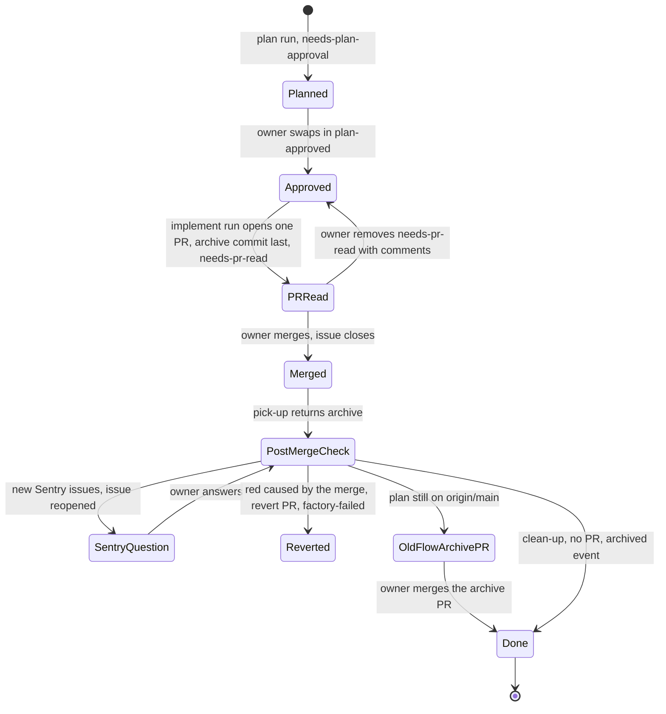

# Plan for #142, Factory: fewer session layers, and the plan archive inside the implementation PR

Issue codysseydev/codyssey-skills#142. Base origin/main be3b506. Branch `factory/142`. Kind: feature.

## Goal

An issue ends in one PR that the owner merges, and a factory issue runs in one session with its subagents. `playbooks/factory.md` gets a session layer rule, and the plan archive moves from a second PR in stage 8 to the last commit of the implementation PR.

## Measured before planning

- No file in the repo describes a coordinator, a per-issue session or `start_session`. The only session rules are the lane prompts (one run per lane, worked in the lane's own session with subagents) and `playbooks/factory.md:30`. The one-session-per-workstream rule lives in the owner's global `~/.claude/CLAUDE.md` ("Sessions and subagents"), outside the repo.
- Stage 8 opens the archive PR at `playbooks/factory.md:121` ("Archive the plan (OpenSpec archive) in its own PR"). `:113` (continue an existing plan-archive PR after a Sentry answer) and `:118` ("Skip the plan archive" on a revert) assume that PR. `:91` does not say where the plan file lives.
- `pick-up.mjs:122-130` returns `archive` from issue state and labels alone. No script reads `.factory/plans/` or looks for an archive PR, so no script changes. The lane prompts (`scheduled-tasks/*/SKILL.md:27-28`) say only "Action archive starts at stage 8" and stay as they are.
- This repo squash-merges: every commit on main since #58 has one parent. A plan file added at the plan stage and deleted in the same PR never reaches main. It stays readable in the PR's commits. #134 said the #66 plan "stays readable in #132 and in git history"; after this change only the first half holds.
- OpenSpec allows both timings. Its team guide (`docs/team-workflow.md`, "When to archive") recommends archiving after the PR merges, offers archiving inside the PR as the second convention, and says to pick one. It says nothing about deploy, and OpenSpec never touches git. Read from the GitHub docs; openspec.dev/docs was not read.
- Open archive-only PRs: 11 (#20, #23, #72, #73, #77, #78, #99, #107, #110, #114, #149), each MERGEABLE and each deleting one plan file. Their issues are closed. Six carry `plan-approved` and `needs-pr-read` (#9, #32, #33, #65, #79, #137) and #10 carries `needs-pr-read` alone. In codyssey, #958 and #959 are open OpenSpec archive PRs.
- 13 more plan files on main (#34-42, #43, #62, #64, #88 to #96) belong to issues the factory did not run and have no archive PR.
- Overlap with running sessions. #150 (#140) edits stage 8's build log sentence and the three lane prompts. #152 (#141) adds a `#### Models and check tiers` section at old line 38, names "the plan archive PR" in its `sonnet` row, and adds an archive-PR tier sentence to stage 8. Both wait for the owner's diff read.

## Default decisions (reversible; approval confirms them)

1. Layer rule scope. The rule goes in `playbooks/factory.md` for factory work only. The run does not edit `~/.claude/CLAUDE.md`. The PR body gives the owner a one-line pointer to add under its "Sessions and subagents" paragraph.
2. "Stays last" without a rebase. A fix after the archive commit goes: `git revert` the archive commit, commit the fix and any plan change, then archive again (`openspec archive <change> --yes`, or `git rm` the plan file). No rebase or force-push. The gates run at that head.
3. Old-flow fallback. Stage 8 opens an archive PR only when the issue's plan is still on origin/main after the merge: an issue planned before this change, or a PR merged without the archive commit. Otherwise it opens none.
4. #142's own PR follows the new flow. Its last commit deletes `.factory/plans/142-*.md`, so its archive run is the first check that stage 8 opens no PR.

## Question for the owner

The issue asks to close or merge the open plan-archive PRs "with the owner's word". Which way?

1. (Recommended) #142's PR also deletes the 11 plan files those PRs delete. After it merges, #142's archive run closes the 11 PRs with a "superseded by" comment and removes `needs-pr-read` and `plan-approved` from #9, #10, #32, #33, #65, #79 and #137. Their post-merge checks already ran when each archive PR opened.
2. The owner merges the 11 archive PRs before #142's PR merges. #142 does not touch them.
3. Leave them open. #142 changes only the playbook, and the owner handles each PR later.

## Changes

### `playbooks/factory.md`

- New `#### Session layers` section after `#### Scheduled pick-up` (after #152's `#### Models and check tiers` once that merges):
  - A run is two layers at most: one session and its subagents. A subagent never starts a session.
  - A factory issue is worked by the session that claimed it, with subagents. It never gets a session of its own: its state lives on the issue (labels, comments, dashboard events) and its branch, so a stop ends the run and the next claim resumes it in a new session. A hand-started run (`claim --only`) works the same way.
  - A session per issue (`start_session`) only for work whose branch or owner stops must outlast the starting session's turn and that has no factory labels to resume from. The section names both cases.
  - A per-issue session ends when its issue's PR merges or the issue closes, and is never reused for the next issue.
  - For factory work this section replaces the global one-session-per-workstream rule.
- Stage 2: name the plan file, `.factory/plans/<issue>-<slug>.md` where the repo has no OpenSpec.
- Stage 4: the last commit before the gates archives the plan, subject `chore(factory): archive the #<issue> plan`: `openspec archive <change> --yes` where the repo uses OpenSpec, else `git rm .factory/plans/<issue>-*.md`. Decision 2 covers later fixes.
- Stage 6 and the babysit items in "Changes to the bundled steps": a review fix follows decision 2.
- Stage 8: retitle to "Post-merge check and clean-up". Keep the post-merge check, the label clean-up and the worktree and evidence clean-up. Replace the "in its own PR" bullet with decision 3. `:113`'s "continue an existing plan-archive PR" applies to the old-flow PR only. `:118`'s "Skip the plan archive" says instead that reverting the merge also un-archives an OpenSpec change, so the next attempt archives it again. The evidence dir goes at the end of the archive run, not after an archive PR merges.
- After #152 merges: its `sonnet` row's "the plan archive PR" becomes "the old-flow archive PR", and its stage 8 tier sentence applies to the old-flow archive PR only.

### Option 1 only

- Delete the 11 plan files listed above.

### Unchanged

- `pick-up.mjs` and its tests, `post-merge.mjs`, the lane prompts, `.factory/playbook.md` (its `## Cleanup` still holds), `factory/factory-onboard`.

## Diagrams

Trigger fired: new transitions on the issue's status, because the archive PR and its owner merge leave the default path. No new actor, module, repo, external system or journey.

Diagram board pending: the Whiteboard publish was refused by the plan run's permission check. Stage 4 draws it first.

## How it gets built

1. Wait for #150 and #152 to merge, then merge origin/main into `factory/142`. Never rebase: the branch is pushed.
2. One delegate edits `playbooks/factory.md` and, under option 1, deletes the 11 plan files. Then the archive commit for `.factory/plans/142-*.md`.
3. Gates and reviews at the head commit from a clean tree, then a ready PR with the evidence table.

## Verification

- Every check in `.factory/recipe.yml` at the head commit from a clean tree.
- `check-playbooks.mjs` reads `.agents/playbooks/` and `~/.agents/playbooks/`, not `playbooks/`, so it never sees this repo's copy. Run it with `HOME` set to a temp dir holding the worktree's `playbooks/factory.md` at `.agents/playbooks/factory.md`, so every quoted anchor in "Changes to the bundled steps" is checked against this pstack.
- `git diff origin/main --stat` lists only `playbooks/factory.md` and `.factory/plans/` deletions, and `.factory/plans/142-*.md` is absent at head.
- Not exercised in the PR: "the next issue that goes through the loop ends in one PR". #142's own archive run, after the install that follows the merge, is the first real check.

## Out of scope

- `~/.claude/CLAUDE.md`, the owner's file.
- The 13 plan files of non-factory issues. A follow-up issue can sweep them.
- codyssey #958 and #959 and other repos' plans. The old-flow fallback archives them.
- Session start-up load (#140, #150) and model tiers (#141, #152).
