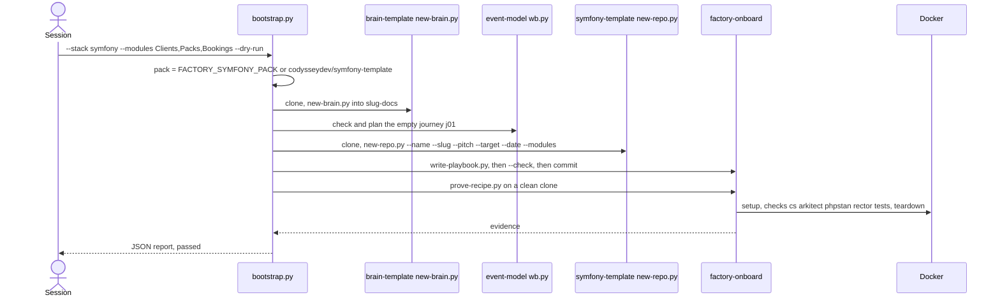
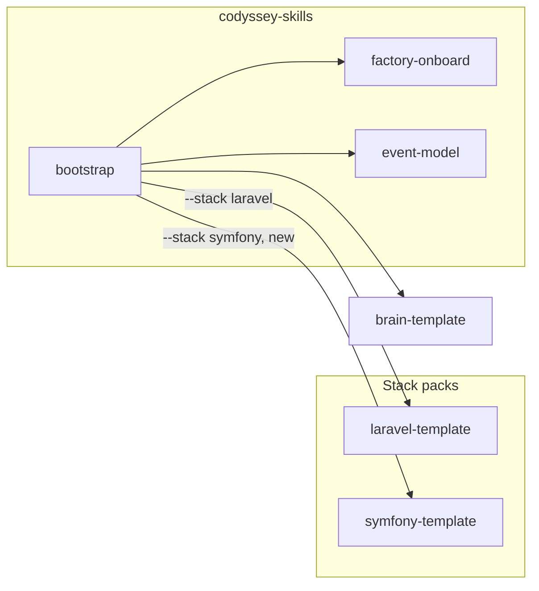

# Plan for #64, bootstrap --stack symfony

Issue codysseydev/codyssey-skills#64. Base origin/main 6485e3a. Branch `factory/64`.

Kind: feature

## Goal

`bootstrap --stack symfony` creates the brain, the journey and a code repo from `codysseydev/symfony-template`, and proves the repo's recipe from a clean clone. `--stack laravel` behaves as before.

## What the code does today

- `factory/bootstrap/scripts/bootstrap.py:17`: `DEFAULT_PACKS = {"laravel": os.environ.get("FACTORY_LARAVEL_PACK", "https://github.com/codysseydev/laravel-template")}`. The issue names `factory/bootstrap/bootstrap.py`; the file is under `scripts/`.
- `:121`: `--stack` takes `choices=sorted(DEFAULT_PACKS)`, so only `laravel` passes. argparse exits 2 on any other value.
- `:124`: the `--pack` help names only `FACTORY_LARAVEL_PACK`.
- `:155`: `resolve_template(args.pack or DEFAULT_PACKS[args.stack], ...)`. `--pack` already overrides the stack's default, and nothing after this line reads the stack.

## First answers checked against the code

The Symfony pack already works with the unchanged script through `--pack`. Run for this plan, from the worktree at 6485e3a:

```
python3 factory/bootstrap/scripts/bootstrap.py --name "Session Pack Tracker" --slug session-pack-tracker \
  --pitch "Counts the sessions left on prepaid coaching packs and applies the 24 hour cancellation rule the same way every time." \
  --modules Clients,Packs,Bookings --stack laravel --pack https://github.com/codysseydev/symfony-template \
  --root <scratch>/root --date 2026-11-23 --dry-run
```

Exit 0, `passed: true`, stderr empty. Steps: brain created, event model journey setup checked and committed, repo created, playbook written (7 sections, nothing unresolved), recipe proved from a clean clone. symfony-template at b2ae0e7. Recipe proof at repo head e401a2c:

| Phase | Step | Exit | Seconds |
|---|---|---|---|
| setup | build | 0 | 0.73 |
| setup | services | 0 | 9.95 |
| setup | install | 0 | 7.71 |
| setup | env | 0 | 1.04 |
| setup | migrate | 0 | 1.37 |
| checks | cs | 0 | 1.44 |
| checks | arkitect | 0 | 1.12 |
| checks | phpstan | 0 | 2.97 |
| checks | rector | 0 | 2.89 |
| checks | tests | 0 | 1.47 |
| teardown | down | 0 | 1.94 |

The Docker image layers were cached, so a cold run takes longer. symfony-template's `scripts/new-repo.py` needs only python3 and git on the host: it sorts imports in Python and calls no php. Its flags match the Laravel pack's (`--name --slug --pitch --target --namespace --modules --date --no-git`), so bootstrap's call at `:172-176` needs no change.

So the change is the default pack lookup, the docs, and the tests. No new step, no new contract.

## Data shape

One registry from stack to environment variable. The default URL follows the template naming both packs share.

```python
PACK_ENV = {"laravel": "FACTORY_LARAVEL_PACK", "symfony": "FACTORY_SYMFONY_PACK"}
DEFAULT_PACKS = {stack: os.environ.get(env, f"https://github.com/codysseydev/{stack}-template")
                 for stack, env in PACK_ENV.items()}
```

`--stack` keeps `choices=sorted(DEFAULT_PACKS)` and the default `laravel`. The `--pack` help is built from `PACK_ENV` ("env FACTORY_LARAVEL_PACK for laravel, FACTORY_SYMFONY_PACK for symfony"). A third stack is one row.

## Changes

### `factory/bootstrap/scripts/bootstrap.py`

- `:17`: replace `DEFAULT_PACKS` with the registry above.
- `:124`: the `--pack` help names each stack's variable.
- The usage line in the docstring (`:5`) shows `--stack laravel|symfony`.

### `factory/bootstrap/SKILL.md`

- `:16`: Stack: `laravel` or `symfony`.
- `:28`: name both variables (`FACTORY_LARAVEL_PACK`, `FACTORY_SYMFONY_PACK`) and state each template's visibility as GitHub reports it (checked at implement).
- `:36`: drop "a Symfony pack is planned"; say both packs keep the same `new-repo.py` contract.
- `:38`: "The pack writes `.factory/recipe.yml`" instead of "The Laravel pack".
- `:51`: say where each pack's `.ai/rules/` come from, as the two templates' READMEs state it.

### `factory/factory-onboard/SKILL.md`

- `:38`: "A stack pack from `bootstrap` (Laravel or Symfony) writes this file for a fresh repo" instead of "The Laravel pack writes this file".
- `:80`: the trusted-commands list gains the PHP CS Fixer config (`.php-cs-fixer.dist.php`).

### `playbooks/factory.md`

- `:90`: the trusted-commands guard list gains the PHP CS Fixer config, so the guard the run applies matches factory-onboard's list (open decision 2).

### `factory/factory-onboard/scripts/write-playbook.py`

- `:32`: `GATE_WORDS` gains `cs` (open decision 1). Today `pint` counts as a gate name and the Symfony template's `composer cs` does not, so a Symfony repo without a recipe loses its coding-standard gate from the `## Checks` table. `cs-fix` still drops out through `fix` in `NOT_GATE_WORDS`.

### `README.md`

- `:68`: "a stack pack (Laravel or Symfony)" instead of "(Laravel today)".

## Tests

| File | Test | Checks | At base |
|---|---|---|---|
| `factory/bootstrap/tests/test_bootstrap.py` | `test_stack_picks_its_pack` | Two fake packs whose recipe echoes a marker. `FACTORY_LARAVEL_PACK` and `FACTORY_SYMFONY_PACK` point at them in the subprocess env, and no `--pack` is passed. `--stack symfony` proves with the symfony marker, `--stack laravel` and no `--stack` with the laravel marker | fails (`--stack symfony` exits 2) |
| same | `test_unknown_stack_refused` | `--stack rails` exits 2 and creates neither folder | passes, guards the choices |
| `factory/factory-onboard/tests/test_write_playbook.py` | a `cs` composer script | A repo with no recipe and composer scripts `cs` and `cs-fix`: the `## Checks` table lists `cs` only | fails |

The three existing bootstrap tests stay as they are. They pass `--pack`, which still wins over the stack.

## Dry run for the PR

At implement, from the worktree head, with the new flag and no `--pack`:

```
python3 factory/bootstrap/scripts/bootstrap.py --name "Session Pack Tracker" --slug session-pack-tracker \
  --pitch "<same as above>" --modules Clients,Packs,Bookings --stack symfony --root <scratch>/symfony --dry-run
```

It passes when the report says `passed: true` and the five checks exit 0. Then the same with `--stack laravel` into another root, so the two runs can be compared, as the vault note "Software Factory Pipeline", section Symfony pack, asks (open decision 3). The evidence tables go in a PR comment, linked from the body. Nothing is pushed and no GitHub repository is created. Each recipe's teardown removes its own containers.

## Gates

From the worktree root, at the head commit, clean tree. The nine checks in `.factory/recipe.yml`. Baseline at 6485e3a, all exit 0: pick-up 108 pass, post-merge 23 pass, capture-ui 115 pass, trial-decision 39 pass, test-first 36 pass, bootstrap 3 OK, event-model 4 OK, factory-onboard 28 OK, install 22 pass.

The repo has no reviewer skill and no `.ai/rules/` (`.factory/playbook.md`, Review). The repo has no PHP, so the Kanon audit does not apply.

## Diagrams

Triggers fired: a flow across two or more repos (bootstrap calls the brain template, the event-model skill, the stack pack and factory-onboard), and a new external system for bootstrap (symfony-template). No new actor, journey or status.





## Out of scope

- `--frontend nextjs` and the Symfony SaaS starter kit (the issue).
- The Symfony rules (#62) and `kanon-pr-audit` (#44).
- Pint's config (`pint.json`) is missing from both trusted-commands lists too. Same kind of gap for the Laravel stack. Filed as a follow-up issue at the PR stage, not changed here.
- Event model and brain vault. Skip, no journey for internal tooling, as in the #29 plan. bootstrap writes journeys for the products it creates; that output does not change.

## Owner follow-ups

- The factory runs the installed copy. The change reaches `~/.claude/skills/bootstrap` on the next `install.mjs` run after merge (`.factory/playbook.md`, Notes).

## Risks

- `DEFAULT_PACKS` reads the environment at import, as today. A test that sets the variables must set them in the subprocess env, which the tests above do.
- The default URL is built from the stack name. A future pack under another name needs its URL in the registry instead. Two rows do not justify a URL column.

## Open decisions

The plan implements each recommended option. Answer on the issue to change one.

1. `cs` as a gate word in `write-playbook.py`.
   - **A. Add it (recommended).** One word and one test. factory-onboard on a Symfony repo without a recipe then lists `composer cs`, as it lists `composer pint` today.
   - **B. Leave it.** The issue asks only for SKILL.md wording. Bootstrap is unaffected either way, because the Symfony recipe covers `cs`.
2. Where the PHP CS Fixer config joins the trusted list.
   - **A. factory-onboard SKILL.md and `playbooks/factory.md:90` (recommended).** The run applies the guard from `factory.md`, so a list only in factory-onboard would not flag a `.php-cs-fixer.dist.php` edit in a factory PR.
   - **B. factory-onboard SKILL.md only**, as the issue says.
3. A Laravel dry run next to the Symfony one in the PR evidence.
   - **A. Run both (recommended).** About a minute each with cached images, and the vault note asks for the comparison.
   - **B. Symfony only.** The acceptance criteria name only the Symfony dry run, and the tests cover `--stack laravel`.
