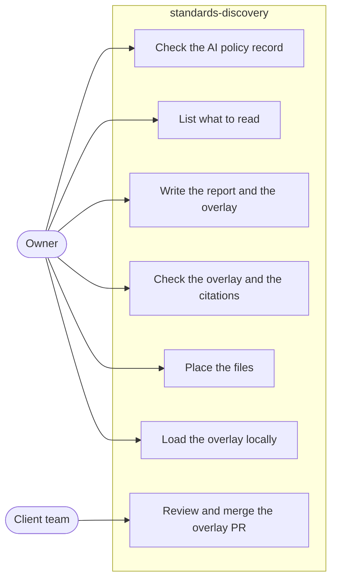
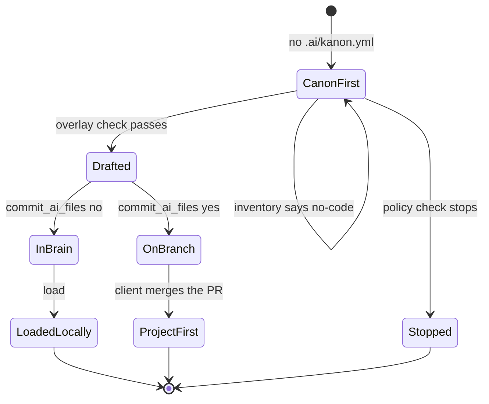
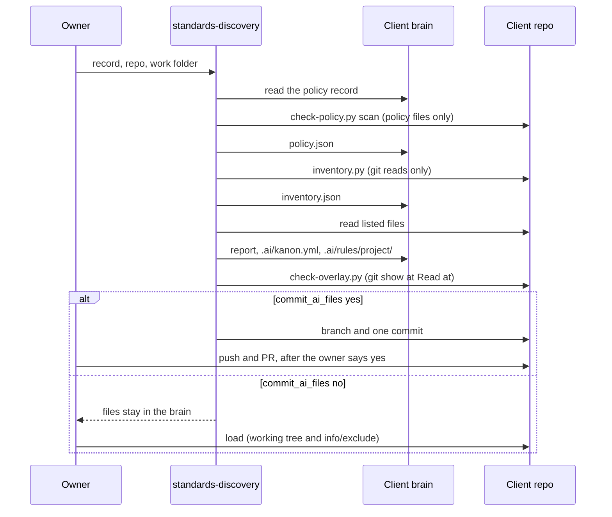

# Plan for #66, standards-discovery: discovery pass, standards report and project overlay

Issue codysseydev/codyssey-skills#66. Base origin/main b87b826. Branch `factory/66`. Kind: feature.

## Goal

After the policy check from #65, `standards-discovery` reads a client's repo and writes what it found. It writes a standards report with `file:line` evidence for each convention, and a project overlay: `.ai/kanon.yml` with `mode: project-first`, one entry per Kanon rule the project adopts, changes or switches off, and prose rule files in `.ai/rules/project/`. Scripts make the checkable parts checkable. One script lists what to read. One script proves the overlay matches its committed schema, every entry names a real Kanon rule, and every citation in the report resolves in the client repo. One script places the files where the policy record allows: a branch in the client repo, or the client's brain with nothing written to the repo.

## Problem

The skill stops after step 1 today.

- `kanon/standards-discovery/SKILL.md:41-43`: "Discovery, the standards report and the overlay writer come in a later change. Stop after step 1."
- The skill has one script, `scripts/check-policy.py`. Nothing writes or checks `.ai/kanon.yml`, and no schema for it exists (`find kanon -name '*schema*.json'` finds only `kanon/catalog/schema.json`, which is the catalog's).
- The owner's decisions. The report and overlay contents (vault `Ideas/Software Factory Pipeline.md:318-319`). Placement: "A branch and PR in the client's repository when their AI policy allows AI files there. Otherwise the report and the overlay live in the client's brain ... kept out of git through `.git/info/exclude`" (`:321`). "No file or no key means canon-first" (`:323`, issue #44 comment).
- Only one Kanon family has rule IDs. `kanon/catalog/` holds `orchestration-di.json` with 37 rules (`ORCH-001` to `ORCH-037`). The other 13 families in `kanon/catalog/families.json` have prose only, so their entries must name a file and a sentence (issue text).
- The reference files wrap sentences across lines. `kanon/laravel-kanon/references/php-core.md:14-15` and `testing.md:16-18` are two examples. A raw substring search fails on 5 of 6 real sentences (Prototype).
- The installed copy cannot see the Kanon. `playbooks/scripts/install.mjs:36,42-49` installs `kanon/standards-discovery/` but not `kanon/catalog/` or any `references/`. The hand-copied `~/.claude/skills/laravel-kanon` on this machine has 10 of 13 reference files, and 5 of those 10 differ from origin/main (`cmp`, Prototype). `~/.claude/skills/standards-discovery` does not exist yet, so no install has run on this machine since #65 merged (inferred).
- `check-policy.py` exposes no record values. Its JSON result has `result`, `blocking` and `warnings` (`check-policy.py:370`), not `commit_ai_files`. The #65 plan said "#66 adds the overlay writer's step" to `STEPS` (`.factory/plans/65-standards-discovery-policy-record.md:93`), but `check-policy.py` belongs to #85 now. This plan reads the field without editing that file (open decision l).

## Behaviour

| Input | Result |
|---|---|
| Policy check exits 1 | The skill stops as in #65. Nothing below runs. |
| Policy check `continue`, the tracked tree has no source file and no rule source | `inventory.py` prints `no-code`. The skill says the repo stays canon-first and writes no overlay. |
| `.aiignore` or `.cursorignore` came back as a `symlink` or `unreadable` warning | `inventory.py` stops. The ignore patterns are unknown, so no path is safe to read. |
| A tracked file the inventory would list differs from `HEAD` | `inventory.py` stops and names the files. The agent reads the working tree and the checker reads `Read at`, so the two must agree. |
| Policy check `continue`, code or rule sources present | `inventory.py` prints the input list. The agent reads it and writes the report, `.ai/kanon.yml` and `.ai/rules/project/*.md` into the work folder in the client's brain. |
| `check-overlay.py` finds a problem | Exit 1 with every problem. The agent fixes the drafts and reruns. `place-overlay.py` refuses until it passes. |
| Record says `commit_ai_files: yes` | `place-overlay.py place` makes a branch (default `standards-discovery/<YYYY-MM-DD>`) in the client repo with one commit holding the overlay and the report. It works in a temporary worktree, so the owner's checkout keeps its branch, `HEAD` and uncommitted files. The agent asks the owner, then pushes and opens the PR. |
| Record says `commit_ai_files: no` | `place-overlay.py place` writes nothing under the client repo, `.git` included. The files stay in the brain. |
| `place-overlay.py load`, record says `commit_ai_files: no` | Copies `.ai/kanon.yml` and `.ai/rules/project/` into the working tree and adds two lines to `info/exclude`. `git status` stays empty. |
| `load` when a target path is tracked, exists untracked with other content, or sits behind a symlink or a file, or the record says `yes` | Stop before any write. A tracked path would show as a change, and an untracked one would be overwritten. A `yes` repo gets the PR instead. |
| Record changed to forbid between steps | `place` reruns the `read-code` check and stops on it. |

## Data shape

### `.ai/kanon.yml`

```yaml
# Written by standards-discovery. The standards report names the commit it read.
mode: project-first
overlay:
  - id: ORCH-011
    effect: adopt
    evidence:
      - .php-cs-fixer.dist.php:9
  - id: ORCH-008
    effect: 'off'
    evidence:
      - CLAUDE.md:12
  - id: TEST-003
    effect: change
    rule: .ai/rules/project/testing.md
    evidence:
      - CLAUDE.md:7
```

- `mode`: `canon-first` or `project-first` (#44). The skill writes only `project-first`, and `check-overlay.py` refuses `canon-first`.
- `overlay` has at least one item (`minItems: 1`). A bare `overlay:` is null to YAML readers, not an empty list.
- `overlay`: a list. Each entry names one Kanon rule by its catalog `id`. Decisions b and d.
- `effect`: `adopt`, `change` or `off`. `change` needs `rule`, a file under `.ai/rules/project/`. `adopt` and `off` have no `rule`.
- `evidence`: one or more `path:line` or `path:line-line` in the client repo. Each item must resolve at `Read at` (an existing, non-blank line) and must also appear among the citations of the entry's row in the report, where it carries a quote. A path may hold spaces (quote the YAML value then) but not `:` or a backtick.
- One entry per Kanon rule. Two entries with the same ID fail.

The committed schema is `kanon/standards-discovery/references/kanon-yml.schema.json`. It uses the keyword subset `kanon/catalog/schema.json` uses (`type`, `required`, `properties`, `additionalProperties`, `enum`, `pattern`, `items`, `minItems`, `oneOf`, `$ref`, `$defs`). An entry is one by-ID shape with `additionalProperties: false`. The `change` needs `rule` check is code, because the subset has no `if`/`then`.

Parsing. Stdlib only, as `check-policy.py` (the repo has no PyYAML: `python3 -c "import yaml"` fails). A strict subset parser accepts only this form: `mode:` at column 0, `overlay:` at column 0, `  - key: value` items, `    key: value` keys, `      - value` list items, and full-line `#` comments. A value is a plain word with no spaces, `: ` or ` #`, a single-quoted string (`''` for a quote, backslashes literal), or a JSON double-quoted string. Anything else stops with the line number and "quote this value". The subset is chosen so YAML 1.1 and 1.2 readers get the same values. Ruby's YAML, a 1.1 reader, read the sample to the same JSON once `off` was quoted (Prototype).

Two rules come from the readers around it:

- `check-policy.py:237` reads `mode` with a column-0 line regex and stops on a second match (`:239-240`). The parser allows `mode` only at column 0, once, and entries are indented. The golden overlay committed at origin/main of a scratch repo read as `project-first` through `client_record` (Prototype).
- Plain `off`, `on`, `yes`, `no`, `true`, `false`, `y`, `n`, `null` and `~` are rejected unquoted. Ruby's YAML read `effect: off` as `false` (Prototype). PyYAML is also a 1.1 reader and resolves `off` the same way (not run here: this machine has no PyYAML). Open decision c.

### Naming a Kanon rule

Every entry names its rule by ID, and the ID must be in `kanon/catalog/<family>.json` (decision d, 2026-11-25). A family without a catalog file has no IDs, so its rules cannot be named. The checker maps the ID's prefix to its family through `families.json` and says the family has no catalog file. #66 merges after #42 converts `symfony`, the last family without one.

### The Kanon root

`check-overlay.py --kanon-root <dir>` names a folder that holds `kanon/catalog/families.json` and the reference paths it lists. The default is the first of two folders that has that file: the skill folder (installed copy, open decision e) and the repo root two levels up (this repo). Tests pass the repo root. A root without `families.json` exits 2.

### The work folder

The agent writes everything in one folder in the client's brain, given as `--work`, for example `<brain>/standards-discovery/acme-shop/`:

```
policy.json            check-policy.py output
inventory.json         inventory.py output
standards-report.md
.ai/kanon.yml
.ai/rules/project/*.md
```

### `inventory.py` output

```json
{
  "result": "inventory",
  "read_at": "861a4986e158aa7491f1a75021c305d7bc872133",
  "ignored": ["app/Legacy/OldBilling.php"],
  "sources": {
    "instructions": ["CLAUDE.md"],
    "docs": [],
    "linters": [".php-cs-fixer.dist.php"],
    "ci": [],
    "scripts": ["composer.json"],
    "pr_templates": []
  },
  "code_files": 4,
  "siblings": {
    "Controller": ["app/Http/Controllers/OrderController.php"],
    "Handler": ["app/Orders/CancelOrderHandler.php", "app/Orders/CreateOrderHandler.php"],
    "Test": ["tests/Orders/CreateOrderHandlerTest.php"]
  },
  "commit_subjects": ["feat(orders): order handlers", "feat(orders): create and cancel handlers", "chore: project setup"],
  "branches": ["feature/ORD-12-cancel-refund", "main"]
}
```

- The universe is `git ls-files` (tracked files only), never a folder walk. Vendor folders are usually untracked, and `vendor/` and `node_modules/` are dropped too.
- `ignored` comes from git's own matcher: `git ls-files -z -c -i -x <pattern>...` with the patterns of every `ignore-file` warning in `policy.json`. An ignored path appears in no other list. A `symlink` or `unreadable` warning on `.aiignore` or `.cursorignore` stops the inventory, because the patterns are unknown.
- Tracked symlinks and submodules (`git ls-files -s` modes `120000` and `160000`) are dropped from every list. A symlink can point outside the repo.
- A listed path that differs from `HEAD` (`git --no-optional-locks diff --name-only HEAD`) stops the inventory with the paths.
- `sources` match the issue's list. Instructions: `CLAUDE.md` at any depth, `AGENTS.md`, `.cursor/rules/**`, `.cursorrules`, `.github/copilot-instructions.md`. Docs: root `README*`, `CONTRIBUTING*` at root, `.github/` and `docs/`, and `docs/**/*.md|rst|txt` (ADRs included). Linters: PHP CS Fixer, Pint, PHP_CodeSniffer, PHPStan, Deptrac, PHPArkitect, Rector, ESLint configs by their file names. CI: `.github/workflows/*.yml|yaml`, `.gitlab-ci.yml`, `bitbucket-pipelines.yml`, `Jenkinsfile`. Scripts: `composer.json`, `package.json`. PR templates: the GitHub locations.
- `siblings`: PHP classes grouped by the last CamelCase word of the file name (`CreateOrderHandler` is a `Handler`), up to 3 per kind, the most recently committed first (order of `git log --name-only`), path as tie-break.
- `commit_subjects`: the last 50 (`git log -50 --format=%s`). `branches`: local and remote branch names.
- `read_at`: `HEAD`, or `null` on an unborn branch.
- `result: no-code` when there is no source file (`.php`, `.js`, `.jsx`, `.ts`, `.tsx`, `.mjs`, `.cjs`, `.vue`, `.py`, `.rb`, `.go`, `.java`, `.kt`, `.cs`, `.rs`, config files excluded) and no rule source (an instruction file, a linter config, `CONTRIBUTING`, or a file under `docs/`). Open decision h.
- It reads through git only and runs no command that writes. It never calls a plain `git status`, which rewrote `.git/index` in the prototype. Any status call uses `git --no-optional-locks`.

### The standards report

```markdown
# Standards report: acme/shop

Read at: 861a4986e158aa7491f1a75021c305d7bc872133
Framework: laravel
Policy warnings: `.aiignore` excludes `app/Legacy/` (1 file not read).

## Conventions

| Convention | Evidence | Source | Kanon rule | Effect |
|---|---|---|---|---|
| Every PHP file opens with `declare(strict_types=1);` | `.php-cs-fixer.dist.php:9` "'declare_strict_types' => true" | configured | ORCH-011 | adopt |
| Facades are used in application code | `CLAUDE.md:12` "Use Laravel facades"; `app/Orders/CreateOrderHandler.php:13` "DB::transaction" | written down | ORCH-008 | off |
| `composer lint` runs PHP CS Fixer as a dry run | `composer.json:7` "php-cs-fixer fix --dry-run --diff" | configured | none | project-only |
| Commit subjects follow Conventional Commits | `commit:861a498` "feat(orders)" | pattern in code | none | project-only |

## Silent on

- architecture
- authorization
- ...
```

- `Read at` is the commit every citation is checked against, through `git show <sha>:<path>`. A moved working tree does not break the check.
- The table's first line is the header and its second line the `|---|` separator. A table without the separator fails, and its first line after the header is checked as a row.
- Evidence items: `` `path:line` `` or `` `path:line-line` ``, each followed by a short quote in double quotes that must appear on the cited lines (whitespace collapsed). A range spans at most 20 lines, in the report and in the overlay's `evidence`. A quote has at least 3 characters that are not spaces, one of them a letter or a digit, so a space or one common letter cannot pass on any line. A quote holds no `"`, `|` or backtick. On a line full of them (a JSON line in `composer.json`, a Markdown table row), the agent quotes a fragment without them, such as `php-cs-fixer fix --dry-run --diff`. No escape grammar to get wrong. Items are separated by `; `. Git history uses `` `commit:<sha>` "<text in the subject>" `` and `` `branch:<name>` ``. Every row needs at least one item. Open decision j.
- Source: `written down`, `configured` or `pattern in code`.
- Kanon rule: a catalog ID, the same one as the overlay entry, or `none`.
- Effect: `adopt`, `change`, `off`, or `project-only` with Kanon rule `none` (open decision k).
- Every overlay entry has a row with the same rule and effect, and every adopt, change or off row has an entry. Every entry's family is in the `Framework`'s family set, the one `Silent on` is compared with.
- `Silent on` lists each Kanon family with no overlay entry, one bullet per family name. The set to compare is every family in `families.json` except `symfony` for `Framework: laravel`, and `symfony`, `php-core` and `reliability` for `Framework: symfony` (the files `symfony-kanon` reads, `README.md:26-29`).

### Prose rule files

`.ai/rules/project/<topic>.md` with `paths:` frontmatter, the form the Symfony template's `.ai/rules/*.md` already use. `check-overlay.py` reads the frontmatter with `parse_frontmatter` imported from `check-policy.py` and needs a non-empty `paths` list. Each `change` entry's `rule` must exist in the work folder.

```markdown
---
paths:
  - "tests/**"
---

# Testing (project rules)

- Test method names **MUST** start with `test_` in snake_case (`test_it_creates_an_order`). Source: `CLAUDE.md:7`. Changes the Kanon's `it_` prefix rule in `testing.md`.
```

### `check-overlay.py`

```
check-overlay.py --work <dir> --repo <client repo> [--kanon-root <dir>]
```

One JSON object, `{"result": "ok" | "invalid", "problems": [{"where": "...", "problem": "..."}]}`. Exit 0 ok, 1 invalid, 2 usage. It reads `policy.json` from the work folder for the ignore patterns, so a citation into an ignored path fails. Pieces: `parse_kanon_yml(text)`, `validate(schema, value)` (a port of `walk` in `kanon/scripts/catalog.mjs:73-130`), `load_kanon(root)`, `resolve(entry, kanon)`, `parse_report(text)`, `check_citation(repo, sha, item, ignored)`, `main(argv)`. Only `main` reads files and runs git.

### `place-overlay.py`

```
place-overlay.py place --record <file> --model <id> --work <dir> --repo <client repo> [--tool claude-code] [--branch <name>] [--subject <text>]
place-overlay.py load  --record <file> --model <id> --work <dir> --repo <client repo> [--tool claude-code]
```

- Both load `check-policy.py` and `check-overlay.py` by path with `importlib`. They run `check(raw, "read-code", ctx)` on the record, then read `commit_ai_files` with `FIELDS["commit_ai_files"][0]`. A stop prints the blocking fields and writes nothing.
- `place` reruns the overlay check and refuses on any problem.
- `place`, `yes`: `git worktree add -b <branch> <temp dir> HEAD` outside the repo, the files copied in, `git add -- <the paths>`, one commit, then `git worktree remove`. The owner's checkout keeps its branch, `HEAD` and uncommitted files. `--branch` defaults to `standards-discovery/<YYYY-MM-DD>` and `--subject` to `docs(ai): project overlay from standards-discovery`. `SKILL.md` tells the agent to pass a name and a subject in the client's own style, read from `inventory.json`. A branch of that name whose tip already holds the same files is a no-op. One that differs stops.
- `place`, `no`: writes nothing under `--repo`. It prints the work folder and the `load` command, each argument quoted with `shlex.quote`.
- `load`: finds the exclude file with `git rev-parse --git-path info/exclude`, which in a linked worktree resolves to the main repo's `.git/info/exclude`, shared by every worktree. Every stop comes before the first write. It appends `/.ai/kanon.yml` and `/.ai/rules/project/` when absent, then copies the files. A second run changes nothing.

## Changes

### `kanon/standards-discovery/SKILL.md`

- Description: drop "Today only the first step is built" and "Discovery, the standards report and the overlay writer come later". Name the report and the overlay.
- Inputs: add the client brain's work folder.
- Step 1: write the check's JSON to `<work>/policy.json`.
- Step 2, inventory: `python3 <skill dir>/scripts/inventory.py --policy <work>/policy.json --repo <repo> > <work>/inventory.json`. On `no-code`, say the repo stays canon-first until the client has rules of their own, and stop.
- Step 3, read: every path in `sources` and `siblings`, and the commit and branch lists. Never a path in `ignored`, never a path outside the inventory. Note each convention with `file:line` and a short quote. What to look for per kind is in `references/reading.md`.
- Step 4, map: read the Kanon from `<skill dir>/kanon/` (decision e). Pick adopt, change, off or project-only per convention. Write the three outputs in the work folder, following `references/overlay.md` and `references/standards-report.md`.
- Step 5, check: `check-overlay.py --work <work> --repo <repo>` until exit 0.
- Step 6, place: `place-overlay.py place ...` with `--branch` and `--subject` in the client's style. On a branch, ask the owner before the push and the PR, because both reach the client. On `no`, tell the owner about `load`.

### `kanon/standards-discovery/references/` (new files)

- `kanon-yml.schema.json`: the schema above.
- `overlay.md`: the `.ai/kanon.yml` form, the quoting rules with the reason for each, how to name a rule, the three effects, and the prose rule file form.
- `standards-report.md`: the report template and the rules the checker applies.
- `reading.md`: what to extract per source kind. The sibling checklist borrows its questions from `general/laravel-standards-review/references/discovery.md:51-63` (controllers, validation, models, DI, enums, types, naming, tests). That skill is not changed.

### `kanon/standards-discovery/scripts/` (new files)

- `inventory.py`, `check-overlay.py`, `place-overlay.py` as in Data shape. Stdlib only (`argparse`, `importlib.util`, `json`, `os`, `re`, `shutil`, `subprocess`, `sys`).
- `check-policy.py` is not changed.

### `kanon/standards-discovery/tests/` (new files)

- `test_inventory.py`, `test_check_overlay.py`, `test_place_overlay.py`. Each loads its script by path with `importlib`, as `test_check_policy.py:13-17` does. Git calls use the same `GIT_ENV` as `test_check_policy.py:20-28`.
- `fixtures/client/`: `CLAUDE.fixture.md`, `.php-cs-fixer.dist.php`, `composer.json`, `.aiignore`, `app/Orders/CreateOrderHandler.php`, `app/Orders/CancelOrderHandler.php`, `app/Http/Controllers/OrderController.php`, `app/Legacy/OldBilling.php`, `tests/Orders/CreateOrderHandlerTest.php`. A builder copies them into a temp folder, renames `CLAUDE.fixture.md` to `CLAUDE.md`, and makes three commits and a `feature/ORD-12-cancel-refund` branch. The rename keeps a second `CLAUDE.md` out of this repo, where Claude Code would load it as instructions for any session reading that folder.
- `fixtures/expected/`: the golden work folder for that repo: `standards-report.md`, `.ai/kanon.yml`, `.ai/rules/project/testing.md`. The report uses `READ_AT` and `COMMIT_2` placeholders the builder fills with the temp repo's shas. It covers all three effects and project-only, both naming forms, all three sources, a `composer.json` script citation, a commit and a branch citation, and the `Silent on` list.
- `fixtures/records-discovery/allowing-commit.md`: `allowing.md` with `commit_ai_files: yes`. No existing record both passes `read-code` and allows committing. The #65 fixture folder `fixtures/records/` is not touched.
- `python3 -m unittest discover -s kanon/standards-discovery/tests` already finds `test_*.py` there, so `.factory/recipe.yml` and `.factory/playbook.md` need no edit.

### `playbooks/scripts/install.mjs` (open decision e)

- `installMap` (`:42-49`): three entries after the `KANON_SKILLS` line. `kanon/catalog/`, `kanon/laravel-kanon/references/` and `kanon/symfony-kanon/references/` go to `<skills>/standards-discovery/kanon/catalog/`, `.../kanon/laravel-kanon/references/` and `.../kanon/symfony-kanon/references/`. The paths in `families.json` then resolve from the skill folder. `map.find` takes the first matching prefix (`:121`), and none of the new prefixes overlaps `kanon/standards-discovery/`. A patched copy ran against temp folders (Prototype).
- No new top-level folder appears in `~/.claude/skills`, so `install.test.mjs:292-294` still holds.

### `playbooks/scripts/install.test.mjs`

- `baseFiles` (`:45-59`): add `kanon/catalog/families.json`, `kanon/laravel-kanon/references/php-core.md` and `kanon/symfony-kanon/references/symfony.md`.
- The install test (`:130-140`): assert all three under `standards-discovery/kanon/`.
- `:288-296` keeps asserting `laravel-kanon` is not installed. `kanon/laravel-kanon/SKILL.md` (`:53`) stays out.

### `README.md`

- `:11`, the `kanon/` row: `standards-discovery` reads a client's codebase and writes a standards report and a project overlay.
- `:30-36`: replace "Today it does one thing" and "Discovery ... come later" with the steps, the three scripts and the two placements.
- Install (`:130-132`): the install also copies the Kanon catalog and references into the skill folder.

## Tests

At base every row fails, because none of the three scripts, the fixtures or the install entries exist.

| Test | Checks | At base |
|---|---|---|
| `golden overlay and report pass` (`test_check_overlay.py`) | The fixture repo and `fixtures/expected/`: exit 0, `ok`, no problems. Acceptance criteria 1 and 2 | fails |
| `schema mutations` | An unknown effect, empty `evidence`, an unknown key, `id` and `file` in one entry, a missing `mode`, `mode: canon-first`, a bare `overlay:` with no items: each named with its path | fails |
| `parse errors name the line` | Plain `off`, a ` #` comment after a value, `: ` in a plain value, a tab, a duplicate key, a wrong indent, a second `mode` | fails |
| `rule resolution` | A made-up ID, an ID of a family without a catalog file (names the family), a `file` and `sentence` entry (the schema refuses it), a report row naming a file and a sentence | fails |
| `one entry per rule` | Two `ORCH-011` entries | fails |
| `overlay evidence` | An evidence item on a blank line, past the end, or missing from its row's citations | fails |
| `citation strictness` | A quote of spaces, one letter or punctuation only, a commit quote of one letter, a 21-line range in the report and in the overlay, a table without its separator (its first row is still checked) | fails |
| `quote and path forms` | A quote holding a double quote or a pipe fails. `docs/Coding Standards.md:3` with a quoted YAML value passes. A row citing `composer.json:7` passes | fails |
| `change and rule files` | `change` without `rule`, `adopt` with `rule`, a `rule` path that does not exist, a rule file without `paths:` | fails |
| `citations` | Past the end of the file, a quote not on the line, a path in `ignored`, `../x`, an absolute path, a blank line, a file absent at `Read at`, a row with no citation, an unknown commit, a commit not reachable from `Read at`, an unknown branch | fails |
| `report and overlay agree` | A row with no entry, an entry with no row, a row whose effect differs from its entry | fails |
| `silent on` | A family missing from the list, an extra family, `symfony` listed for `Framework: laravel`, an `ORCH` entry under `Framework: symfony` | fails |
| `check-policy reads the overlay's mode` | The golden `.ai/kanon.yml` committed at `refs/remotes/origin/main` of a temp repo. `client_record({}, ...)` gives `project-first` and stops on `record` | fails |
| `kanon root` | A copy laid out as the installed skill folder resolves. A root without `families.json` exits 2 | fails |
| `inventory of the fixture` (`test_inventory.py`) | The JSON above: sources by kind, siblings, `ignored`, `read_at` equals `HEAD`, subjects, branches | fails |
| `inventory needs a continue` | A `stop` policy JSON: exit 1, and no git command runs in the repo | fails |
| `ignore patterns use git's matcher` | `secrets` matches `a/secrets/k.php`, `**/secret*` matches `secrets/k.php`, a negated child of an ignored folder stays ignored | fails |
| `ignore file not readable` | A policy JSON with a `symlink` warning on `.aiignore`: exit 1, nothing listed | fails |
| `symlinks and dirty paths` | A tracked symlink and a submodule appear in no list. An edited `CLAUDE.md` stops with its path | fails |
| `no code` | An unborn repo and a repo with `README.md` and `composer.json` give `no-code`. A repo with only `README.md` and `CLAUDE.md` gives `inventory` | fails |
| `inventory writes nothing` | A snapshot of every file under the repo, `.git` included (bytes and mtime), is the same before and after | fails |
| `forbidding record writes nothing to the repo` (`test_place_overlay.py`) | `allowing.md` (`commit_ai_files: no`): inventory, check and `place` in a row leave the repo snapshot unchanged. Acceptance criterion 3 | fails |
| `allowing record makes a branch` | `allowing-commit.md`: branch `standards-discovery/<date>` with one commit holding exactly the overlay and the report. The checkout keeps its branch, `HEAD` and an uncommitted edit. `--branch` and `--subject` are used when given. A rerun is a no-op | fails |
| `place refuses` | A failing overlay check, and `forbidding.md`: exit 1, the repo snapshot unchanged | fails |
| `load` | In a linked worktree: the files land, `info/exclude` gains two lines once over two runs, `git --no-optional-locks status --porcelain` is empty. A tracked `.ai/kanon.yml` stops. An untracked one with other content, and a file named `.ai`, stop with the repo unchanged. A `yes` record stops. The printed `load` command survives a work path holding `; ` | fails |
| `install: the Kanon snapshot` (`install.test.mjs`) | The catalog and both reference folders land under `standards-discovery/kanon/`. `laravel-kanon` is still not installed | fails |

## Gates

From the worktree root, at the head commit, clean tree. The 12 checks in `.factory/recipe.yml`. The plan adds no check: the new Python tests run inside `standards-discovery-tests`, the install test inside `install-tests`. `playbooks/factory.md` does not change, so `check-playbooks.mjs` does not apply.

Baseline at b87b826, node v26.13.0, Python 3.15.2, clean tree:

| Gate | Command | Exit | Result |
|---|---|---|---|
| pick-up-tests | `node --test playbooks/scripts/pick-up.test.mjs` | 0 | 108 pass |
| post-merge-tests | `node --test playbooks/scripts/post-merge.test.mjs` | 0 | 23 pass |
| capture-ui-tests | `node --test playbooks/scripts/capture-ui.test.mjs` | 0 | 115 pass |
| trial-decision-tests | `node --test playbooks/scripts/trial-decision.test.mjs` | 0 | 39 pass |
| test-first-tests | `node --test playbooks/scripts/test-first.test.mjs` | 0 | 36 pass |
| bootstrap-tests | `python3 -m unittest discover -s factory/bootstrap/tests` | 0 | 3 OK |
| event-model-tests | `python3 -m unittest discover -s factory/event-model/tests` | 0 | 4 OK |
| factory-onboard-tests | `python3 -m unittest discover -s factory/factory-onboard/tests` | 0 | 28 OK |
| standards-discovery-tests | `python3 -m unittest discover -s kanon/standards-discovery/tests` | 0 | 54 OK |
| install-tests | `node --test playbooks/scripts/install.test.mjs` | 0 | 29 pass |
| kanon-catalog-check | `node kanon/scripts/catalog.mjs check --base origin/main` | 0 | "catalog ok: 1 family file(s), 37 entries" |
| kanon-catalog-tests | `node --test kanon/scripts/catalog.test.mjs` | 0 | 33 pass |

The implementation PR changes no gate of this repo. Its fixtures add a `composer.json` with scripts and an `.ai/rules/project/` folder under `kanon/standards-discovery/tests/fixtures/`, so a path-based reading of the trusted-commands guard (`playbooks/factory.md:104`) flags them. The PR says so.

The tests prove the scripts. They cannot prove an agent writes a good report. At implement, the run also does one real pass: the skill on the fixture repo with `allowing.md`, then `check-overlay.py` on what the agent wrote. The PR records the command, the exit code and the problem count.

## Prototype

Run in a scratchpad, not committed.

- Sentence matching against the real references. Six whole sentences: `php-core.md:14-15`, `testing.md:8` (`#[Test]`), `testing.md:9-11` (Pest), `testing.md:16-18` (`it_`), `testing.md:8-9` (`Tests\TestCase`) and `symfony.md:8-9` (`$container->get()`). A raw substring found 1 of the 6, the one on a single line. After joining lines and collapsing whitespace, all 6 matched exactly once. `**MUST**` alone failed ("does not end a sentence"). The same sentence without its subject and keyword failed ("no bold keyword"). `Tests **MUST** use Pest.` matched 0 times. `ORCH-002`'s "An orchestrator **MUST NOT**:" in `orchestration-di.md` was refused with "this family has IDs".
- ID lookup over `kanon/catalog/`: 37 IDs, one family with a catalog. `ORCH-011` resolved. `ORCH-099` and `TEST-001` did not.
- The subset parser on the sample `.ai/kanon.yml` above, then the schema port: no errors. Mutations gave `must be one of ['adopt', 'change', 'off'] (got 'enable')`, `must have at least 1 item(s)` and `unknown property "file"`. Parse errors named their lines: `Tests **MUST**: use x` ("quote this value"), `adopt # yes`, a second `mode`, a 3-space indent.
- Ruby 3.1's YAML (Psych 3.1.0) on the same file: the JSON differed only in `"effect": false` for the plain `off`. With `'off'` the two parses were equal. Ruby also read a top-level `off: [a]` key as `false`.
- The overlay committed at `refs/remotes/origin/main` of a scratch repo. `check-policy.py`'s `client_record({}, "acme/shop", repo)` returned `('project-first', None, [{'field': 'record', 'reason': 'missing, no registry entry'}])`. With an entry it returned the record path.
- The fixture repo above, `check-policy.py --record allowing.md`: `continue`, one `ignore-file` warning with `app/Legacy/`. The inventory prototype printed the JSON in Data shape, with `app/Legacy/OldBilling.php` only in `ignored`.
- Git's matcher against `fnmatch` on a scratch repo. Both agreed on `*.env`, `/secrets/` and `/root.php`. For `secrets`, `**/secret*` and `secrets/` plus `!secrets/keep.php`, `fnmatch` missed 1 or 2 files each, so it fails open. Git's matcher kept `secrets/keep.php` ignored, because git does not re-include a file under an excluded folder. That fails closed.
- A hand-written report for the fixture (the pass an agent would make), checked by the citation prototype. Five rows with file citations passed. Mutations: line 99 ("past the end (12 lines)"), a wrong quote ("quote not on the cited line"), the ignored file, `../etc/passwd`, a blank line and a missing file each failed. The commit-subject row had no `file:line`, which led to the `commit:` and `branch:` forms. `commit:<sha>` and `branch:feature/ORD-12-cancel-refund` resolved, `deadbeef` and `nope` failed.
- `Silent on` computed from the sample overlay (families `orchestration-di` and `testing` touched): the other 11 Laravel families.
- Record reads through the imported functions: `allowing.md` gave `commit_ai_files` `no` with no blocking, a copy with `yes` gave `yes`, `forbidding.md` stopped on `ai_allowed` and `code_leaves_machine`. No change to `check-policy.py`.
- Acceptance criterion 3. A snapshot of every file under the fixture repo, `.git` included (sha256 and mtime), was identical after the inventory and a citation check. A plain `git status --porcelain` then changed `.git/index`. `git --no-optional-locks status --porcelain` changed nothing.
- `load` in a linked worktree, whose `.git` is a file. `git rev-parse --git-path info/exclude` gave the main repo's `.git/info/exclude`. After the copy, status was empty. A second run left one line per pattern. With `.ai/kanon.yml` tracked, `load` stopped.
- No-code: an unborn repo and a `README.md` plus `composer.json` repo gave `no-code`. A `README.md` plus `CLAUDE.md` repo gave `inventory`.
- The allowed path: a clone, a `standards-discovery/2026-11-24` branch and `git add -- <paths>` gave one commit with exactly `.ai/kanon.yml`, `.ai/rules/project/testing.md` and `.ai/standards-report.md`.
- `install.mjs` maps a commit path with `map.find` on prefixes (`:121`) and writes `join(target.dir, rest)` (`:126`). A copy of `install.mjs` and `pick-up.mjs` with the three entries added ran `--source <this worktree> --ref HEAD` into temp folders: `installed`, 17 files under `standards-discovery/kanon/` (3 catalog, 13 Laravel references, 1 Symfony), and the top-level skills folder still listed the five factory skills and `standards-discovery` only. The resolver pointed at that installed folder read 37 IDs and matched the `php-core.md:14-15` sentence once.
- Every rule item in the 13 prose references (each list item with a bold keyword, 173 items) through the sentence matcher. The sentence around each item's first keyword matched exactly once in 173 of 173. No bold keyword sits outside a list item. So every prose rule can be named under acceptance criterion 2.
- Inventory edges on a clone of the fixture with a tracked symlink and an edited handler. `git ls-files -s` showed the link with mode `120000`. `git --no-optional-locks diff --name-only HEAD` named the edited file. Neither call changed a byte under the repo.
- `place` through a temporary worktree on that dirty clone: `worktree add -b`, copy, `add`, `commit` and `worktree remove` all exited 0. The checkout stayed on `main` with the same `HEAD` and its edited file. The branch held one commit with the two overlay files.

## Event model

Skip. No journey board for internal tooling, as the #65 plan did. In `codyssey-docs`, `grep -rlni -e standards-discovery -e "project overlay" -e project-first --exclude-dir=.git --exclude-dir=.claude .` finds only `Ideas/` notes (Kanon Rule Catalog, Software Factory Pipeline, Ideas Inbox, Codebase Care Service, Software Factory Build Log).

## Diagrams

Fired triggers: two or more actors (the owner and the client team that merges the PR), a new status with transitions (the repo's mode and where its overlay lives), and a flow across repos (this skill, the client repo and the client's brain). No new module or external system, so no context map.

Use cases:



The repo's mode:



`LoadedLocally` is project-first for tools that read the working tree. A factory run reads origin/main and finds no file, so it uses the registry from #65.

The flow:



## Out of scope

- The test runs on the Codyssey backend and `symfony/demo` (#67).
- The catalog-format overlay, and replacing the prose rule files with catalog entries (issue).
- Changes to `check-policy.py`, `test_check_policy.py`, `references/policy-record.md`, `playbooks/factory.md` and `.factory/playbook.md`. #85 owns them.
- `.factory/playbook.md:30` lists what a merged change takes effect from. With decision e, `kanon/catalog/` and the reference folders join that list. That edit waits for #85 (owner follow-up).
- Forbid rules for `cloud_sessions` and `retention`. The drafts stay in the brain whatever `retention` says. Adding a rule needs a `check-policy.py` edit.
- A factory step that runs discovery. The skill runs in interactive sessions.
- Unloading a locally loaded overlay. Deleting the two files and the two exclude lines undoes it.

## Owner follow-ups

- After merge, run `install.mjs` once. The skill, the scripts and the Kanon snapshot reach `~/.claude/skills/standards-discovery` then.
- The hand-copied `~/.claude/skills/laravel-kanon` stays stale. The skill does not read it.
- After a client merges an overlay PR, origin/main says `mode: project-first`, and factory runs on that repo stop on `record` until the registry has an entry (`check-policy.py:251-252`). Add the entry before or with the merge.
- After #85 merges, add `kanon/catalog/` and the reference folders to `.factory/playbook.md:30`.

## Risks

- The report and the overlay come from a model. The checker proves the shape, the rule names and that each citation points at a real line holding the quoted text. It cannot prove the convention is right. #67 measures that against an answer key.
- The overlay entry's `evidence` has no quote, only `path:line`. The checker resolves each item and needs it among the quoted citations of the entry's report row. The prototype's first draft cited a blank line (`CLAUDE.md:11` for the facades rule, the report said `:12`), which only this cross-check catches.
- A quote cannot hold `"`, `|` or a backtick, and a path cannot hold `:`. A line made only of those characters cannot be quoted. The agent then cites a neighbouring line or another source.
- Line citations go stale when the client's code moves. `Read at` pins the check to one commit, so the report stays checkable, and a rerun gives fresh lines.
- Quoting `'off'` is a rule the agent can forget. The parser stops on the plain form and names the line, so a forgotten quote costs one rerun.
- Only families with a catalog file can be named. #66 merges after #42, so every family has one by then (decision d).
- The install never deletes. A reference file removed from the repo stays in the snapshot. The checker accepts only files `families.json` lists, so a stale file is never matched. Catalog IDs are never deleted (`kanon/scripts/catalog.mjs:388-394`).
- `info/exclude` is shared by every worktree of the client checkout. A loaded overlay is hidden in all of them, which is the intent.
- The no-code rule counts a fresh framework skeleton as code. A client repo that is only `laravel new` output gets an overlay built from framework defaults (decision h, option C).

## Decisions

a. Checker language and schema form.
   Decided 2026-11-24 by the owner: A.
   - **A. Python, stdlib, with a JSON Schema file and a Python port of the catalog validator's keyword subset (recommended).** Same language as `check-policy.py`, so it imports `parse_frontmatter`, `check` and `FIELDS` directly. The schema file is the one the issue asks to commit. Cost: about 50 lines that copy `kanon/scripts/catalog.mjs:73-130`.
   - B. Node, importing `validate` from `kanon/scripts/catalog.mjs`. No copy of the validator, but `catalog.mjs` is not installed, a YAML subset parser is still needed in JS, and the record read would shell out to Python.
   - C. Python with the shape as a table in code and no schema file. Least code, and nothing to commit as "a schema".

b. The overlay's shape. #44 names "adopt, change and off entries" and no layout.
   Decided 2026-11-24 by the owner: A.
   - **A. One `overlay:` list, each entry with `effect:` (recommended).** One entry per rule is one list to check for duplicates. The report row and the entry carry the same fields. A later catalog-format entry stays one list.
   - B. Three lists, `adopt:`, `change:`, `off:`. Reads well, but `off:` as a key is a YAML 1.1 boolean (Ruby read `{false=>[...]}`), so it needs quoting too, and a rule could sit in two lists.

c. The YAML 1.1 boolean words.
   Decided 2026-11-24 by the owner: A.
   - **A. Keep `off` and require quotes on `off`, `on`, `yes`, `no`, `true`, `false`, `y`, `n`, `null` and `~` (recommended).** Keeps #44's word. Every YAML reader then agrees.
   - B. Rename the effect to a word no reader turns into a boolean, for example `disable`. No quoting rule, but it changes #44's vocabulary.
   - C. Accept plain `off`. YAML 1.2 readers agree. Ruby's Psych read `false`, and PyYAML resolves it the same way (not run here).

d. Naming a rule from a family that has IDs.
   Decided 2026-11-24 by the owner: A.
   - **A. ID required once the family has a catalog file (recommended).** Matches the issue's "after that, by ID". One name per rule makes the duplicate check exact. Cost: a client overlay's sentence entries fail when their family gains IDs, and the message names the ID to use.
   - B. Both forms accepted always. No migration, but one rule can then appear twice under two names.
   Revised 2026-11-25 by the owner: drop the file-and-sentence form. Every entry names a rule by catalog ID. A family without a catalog file (only `symfony` today) cannot be named, and the checker says so. #66 merges after #42 converts `symfony`. The sentence parser, the `file` and `sentence` schema branch and their tests are removed.

e. How the installed skill finds the Kanon. Today it cannot: the install copies no catalog and no references, and the hand copy of `laravel-kanon` is stale.
   Decided 2026-11-24 by the owner: A.
   - **A. Install a snapshot of `kanon/catalog/` and both `references/` folders into the skill folder through three `installMap` entries (recommended).** The checker and the agent read the same text, from `origin/main`, refreshed by every install. Cost: `install.mjs` and `install.test.mjs` edits, and files removed from the repo stay installed.
   - B. A required `--kanon-root` pointing at the owner's codyssey-skills checkout. No install change, but the run reads a working copy that can be stale or dirty, which `install.mjs` avoids by reading the commit.
   - C. A generated `references/kanon-index.json` (IDs and sentences) committed in the skill, with a recipe check that it matches. Self-contained, but a second copy of every rule and one more gate.

f. Acceptance criterion 3, "nothing is written to the client repository", next to the vault's local load through `.git/info/exclude`.
   Decided 2026-11-24 by the owner: A.
   - **A. `place` writes nothing under the repo, `.git` included. A separate `load` command, run when the owner wants the overlay active, copies the files and edits `info/exclude` (recommended).** The criterion holds literally for the discovery run, and the test is a byte and mtime snapshot. The vault's local load still exists as an explicit step. Cost: two commands, and the owner runs `load` again after a rerun.
   - B. Nothing reaches git. `place` copies the files and edits `info/exclude` in the same run. The test is an empty `git status` and an unchanged `HEAD`. One command, but the working tree and `.git/info/exclude` are written, which a literal reading of the criterion forbids.
   - C. Never load locally. The overlay lives only in the brain, and readers find it there. Drops the vault's `.git/info/exclude` design, and every reader of `.ai/kanon.yml` (#44's audit, the writing skill) needs the brain path.

g. Where the report goes when AI files are allowed.
   Decided 2026-11-24 by the owner: A.
   - **A. `.ai/standards-report.md` in the same commit as the overlay (recommended).** The vault groups "the report and the overlay" (`:321`). The client sees the evidence next to the rules. Cost: a file whose line numbers go stale in the client's repo.
   - B. The report stays in the brain. The PR body carries a summary. Nothing stale in the client repo, but the client reviews rules without the evidence.
   - C. Both. Two copies to keep in step.

h. What "no code" means. The issue says a repo with no code "stays canon-first until the client has rules of their own". The vault's readiness drill expects a repo with a style guide and no code to be project-first (`:338`).
   Decided 2026-11-24 by the owner: A.
   - **A. No source file and no rule source in the tracked tree (recommended).** `README.md`, `LICENSE` and `composer.json` alone are no code. An unborn branch is no code. A `CLAUDE.md` or a linter config alone gives an overlay from the written rules, which fits the drill.
   - B. No source file, whatever is written down. Simpler, and the drill repo then stays canon-first.
   - C. As A, and a bare framework skeleton counts as no code too. Closer to "the client's own code", but needs a skeleton file list per framework.

i. How much of discovery is a script.
   Decided 2026-11-24 by the owner: A.
   - **A. A script lists the inputs and the agent reads them (recommended).** Tracked files only, policy ignores through git's matcher, sources by kind, siblings, commit and branch lists, `read_at`, `no-code`. The ignore handling and the no-code rule get tests.
   - B. Prose in `SKILL.md` only. Nothing to build, and nothing proves an ignored path stays unread.
   - C. A, plus extracting settings from configs (PHP CS Fixer rules, the PHPStan level). Deterministic for those, but one parser per tool, and a PHP CS Fixer config is PHP code.

j. The report format.
   Decided 2026-11-24 by the owner: A.
   - **A. One table, each evidence item with a short quote the checker finds on the cited line, and `Silent on` as one bullet per Kanon family with no entry, compared with the computed set (recommended).** Both parts are checked. Cost: the agent copies a quote per citation.
   - B. The same table without quotes. A citation then only has to land inside the file.
   - C. One section per convention, free text. Easier to read, and much harder to check.

k. Conventions the Kanon has no rule for (the fixture's `final_class` setting, Conventional Commits). The issue and #44 define only adopt, change and off.
   Decided 2026-11-24 by the owner: A.
   - **A. A report row with Kanon rule `none` and effect `project-only`, and the rule in a prose file under `.ai/rules/project/` when the code shows it but nothing writes it down. No overlay entry (recommended).** Keeps #44's format. The writing skill finds the rule in `.ai/rules/`, which `playbooks/factory.md:102` already treats as project rules.
   - B. Leave them out. The report is shorter, and #67's answer key (the backend's 23 rules) will count them as missed.
   - C. A fourth effect, `add`, in `.ai/kanon.yml`. Changes the format #44 decided.

l. Where the overlay writer's step lives. The #65 plan said #66 adds it to `STEPS` in `check-policy.py` (`.factory/plans/65-standards-discovery-policy-record.md:93`), and #85 owns that file now.
   Decided 2026-11-24 by the owner: A.
   - **A. `place-overlay.py` runs `check(raw, "read-code", ctx)` and reads `commit_ai_files` through the imported `FIELDS` (recommended).** No edit to `check-policy.py`, no conflict with #85. Cost: the rule "placement follows `commit_ai_files`" lives in a second script.
   - B. Add a `write-overlay` step to `STEPS` after #85 merges, and make #66 depend on #85. One table holds every rule, at the cost of a wait.
   - C. Edit `check-policy.py` now. Conflicts with #85's branch.
