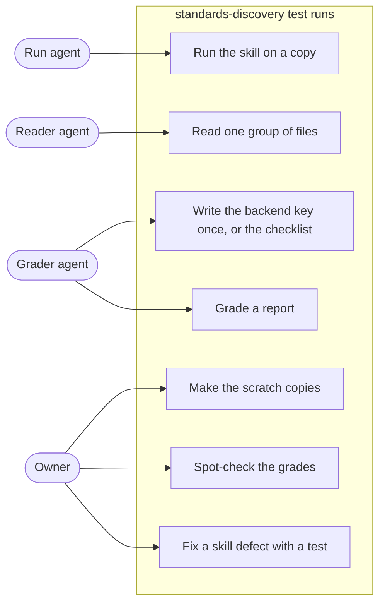
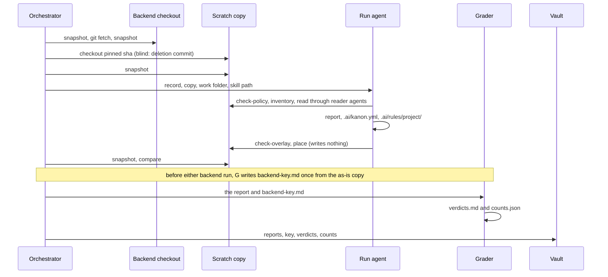

# Plan for #67, standards-discovery: test runs on the Codyssey backend and symfony/demo

Issue codysseydev/codyssey-skills#67. Base origin/main 17ad8df. Branch `factory/67`. Kind: feature.

## Goal

Run `kanon/standards-discovery` three times before it meets a client. Run 1 reads the Codyssey backend as it is. Run 2 reads a copy of the backend without `CLAUDE.md`, `AGENTS.md` and `.ai/`. Run 3 reads `symfony/demo`. For each backend run, count the answer-key rules the skill found again, the ones it missed, and the conventions it reported that the answer key lacks, each checked as real or made up. Judge run 3 without an answer key. Fix what the runs show in the skill, in the same PR, each fix with a test where one can be written. Nothing is written to `codysseydev/codyssey` or `symfony/demo`.

## Problem

The skill has only run on its own 9-file fixture. The planning dry run of steps 1 and 2 (policy check and inventory) on copies of both repos already shows three gaps (Prototype):

- The as-is run cannot read the answer key. `inventory.py:41-43` lists `CLAUDE.md`, `AGENTS.md`, `.cursor/rules/**`, `.cursorrules` and `.github/copilot-instructions.md` as instructions, and nothing under `.ai/rules/`. On the as-is copy, `instructions` held 2 files. `check-overlay.py` recomputes the listed paths, so a citation into `.ai/rules/*.md` fails even if the agent reads the file. Runs 1 and 2 then differ by two files.
- The read does not fit in one agent. On the as-is copy, the inventory lists 1167 files: 105 sources and 1062 siblings in 742 kinds, 164222 lines, 8.7 MB, about 2.2M tokens. `SKILL.md` step 3 says "Read every path in `sources` and `siblings`".
- `sibling_kind` (`inventory.py:206-209`) makes a kind of anything that is not a CamelCase class. 544 kinds hold one file, and 68 files are `.blade.php` templates (kinds such as `404.blade`). In symfony/demo, `bundles`, `preload` and `index` became kinds.

The issue's framing has two more gaps:

- "Its 23 rules in `.ai/rules/`". At 5b7c260b (the backend's origin/main on 2026-11-26) `.ai/rules/` holds 23 files. One is `index.md`, a generated routing table with no rule in it. So the answer key has 22 rule files plus `CLAUDE.md`. The 23 files hold 149 `##` sections and 574 list items. The vault adds that 10 of the rules apply only to Codyssey and 8 should not be public (`Ideas/Software Factory Pipeline.md:345`).
- "Put the reports and the counts in the PR". `codysseydev/codyssey-skills` is public and `codysseydev/codyssey` is private (`gh repo view --json visibility`). A backend report quotes private code and rules with `file:line`. Open decision c.

## Behaviour

| Input | Result |
|---|---|
| Copy step | Each repo becomes a fresh scratch repo with no remote, at a pinned commit. The backend copy is a `git fetch` from the local checkout (decision d). It is the only command that touches the original. |
| Run 1, backend as is | One run agent follows `SKILL.md` on the copy with its own record. The work folder ends with `policy.json`, `inventory.json`, the report, `.ai/kanon.yml` and `.ai/rules/project/*.md`. `check-overlay.py` exits 0. `place-overlay.py place` exits 0 and writes nothing under the copy. |
| Run 2, backend blind | As run 1, on a copy whose tip commit deletes `CLAUDE.md`, `AGENTS.md` and `.ai/`. |
| Run 3, symfony/demo | As run 1, on a full clone at a pinned commit. `Framework: symfony`. |
| Grading, backend runs | A grader agent, which never saw a run, writes one key for both backend runs from the as-is copy at the pinned sha, before either report exists. Then it grades each report against that key. The owner spot-checks (decision b). |
| Grading, symfony/demo | The grader writes a checklist from the listed configs before it reads the report, then checks every row as real or made up. |
| A run hits a skill defect | It goes in the findings table. A defect in a script gets a failing test, then the fix, in separate commits. A defect in prose (`SKILL.md`, `references/`) gets the fix and a line saying no test covers it. |
| The record says `commit_ai_files: no` | `place` writes nothing. No run calls `load`. The overlay never reaches any branch of any repo. This answers the last risk in the #65 plan. |

## Data shape

### The scratch layout

Every output goes under one folder in the implement session's scratchpad, `<scratch>/67-runs/`:

```
copies/backend-as-is/     scratch repo, main at the pinned backend sha
copies/backend-blind/     same refs, main is one commit ahead (the deletion)
copies/symfony-demo/      full clone, main at the pinned sha, origin removed
records/<run>.md          one policy record per run
work/<run>/               the skill's work folder: policy.json, inventory.json,
                          standards-report.md, .ai/kanon.yml, .ai/rules/project/*.md
snap/                     snapshots of the original checkout and of each copy
grades/backend-key.md     the one answer key both backend runs are graded against
grades/<run>/             checklist.md (symfony), verdicts.md, counts.json
findings.md               one row per defect: run, step, symptom, evidence path, class, fix commit
```

The scratchpad is cleared on reboot. At the end, the backend runs' `work/`, `grades/` and counts go to the vault (decision c). The symfony/demo outputs go to the PR.

### The copies

Backend, as is (decision d):

```
git -C <backend> --no-optional-locks rev-parse refs/remotes/origin/main     # the pinned sha
git init -q -b main copies/backend-as-is
git -C copies/backend-as-is -c core.hooksPath=/dev/null fetch -q --no-tags <backend> '+refs/remotes/origin/*:refs/remotes/origin/*'
git -C copies/backend-as-is checkout -q -B main <sha>
```

Backend, blind. The same fetch from `copies/backend-as-is`, then one commit made with a run identity, not the owner's:

```
git -C copies/backend-blind rm -q -r CLAUDE.md AGENTS.md .ai
git -C copies/backend-blind -c user.name='standards-discovery run' -c user.email='runs@example.invalid' -c core.hooksPath=/dev/null commit -q -m 'chore(ai): remove agent instruction files'
```

The commit keeps `Read at` and every citation resolvable. The subject follows the repo's Conventional Commits style, and it is 1 of the 50 subjects the inventory lists. `.claude/rules`, a tracked symlink to `../.ai/rules`, dangles after the deletion. The inventory drops symlinks.

symfony/demo: `git clone https://github.com/symfony/demo.git`, `checkout -B main <sha>`, `remote remove origin`. A full clone, because a depth-1 clone lists 1 commit subject. The planning pin is `f42980c6` (2026-11-06). The implement session re-pins both repos to their tips then and records the shas.

### The policy record, one per run

```markdown
---
ai_allowed: yes
tools: [claude-code]
models:
  - claude-opus-*
code_leaves_machine: model-provider
cloud_sessions: no
commit_ai_files: no
retention: end-of-engagement
---

Source: test run for codyssey-skills#67 on <repo>. The owner's own code (backend) or MIT code (symfony/demo), read on this machine.
```

`models` covers every agent that reads code: the run agent, its readers and the grader (decision e). Each passes its own model id to `--model`.

### `counts.json`, one per run

```json
{
  "run": "backend-blind",
  "read_at": "<sha>",
  "skill_sha": "<factory/67 sha the run used>",
  "model": "claude-opus-5-5",
  "check_overlay_exit": 0,
  "place_exit": 0,
  "rows": 41,
  "found": { "files": 9, "of": 23, "key_conventions": 14, "of_keys": 52,
             "by_source": { "written down": 6, "configured": 2, "pattern in code": 1 } },
  "missed": { "files": 14 },
  "extra": { "real": 11, "made_up": 2 }
}
```

The numbers above are placeholders. For symfony/demo, `found` and `missed` are replaced by `checklist: { "found": n, "of": m }`.

### Grading

Decision b, option A, is built in here.

- The answer key has 23 items: the 22 rule files and `CLAUDE.md`. `index.md` is left out.
- Once, before either backend report exists, the grader writes 1 to 3 key conventions per item in `grades/backend-key.md`, each with `file:line` in `copies/backend-as-is` at the pinned sha. The owner checks it once. It is frozen, and runs 1 and 2 are both graded against it, so their counts compare.
- A report row matches a key convention when it states the same constraint over the same scope. A row that names the topic only, or states a different or opposite constraint, does not match.
- In the blind run, a match also needs a citation in the blind copy that shows the convention. A row whose only support is the Kanon's wording does not count. The Kanon was written from the same doctrine (Risks).
- An item is found again when at least one of its key conventions is matched. Otherwise it is missed.
- An extra is a row that matches nothing in the 22 files or `CLAUDE.md`. The grader checks the full file text, not only the key list. Each extra is real when the cited lines and the code at `Read at` show it, and made up when they do not or contradict it.
- `verdicts.md` has one line per key convention (matched row number or none, one-line reason) and one per extra (real or made up, one-line reason).
- The owner spot-checks every made-up verdict and 5 found verdicts per run, picked at random.

symfony/demo has no answer key. It is judged on:

- `check-overlay.py` exit 0, and `place` exit 0 with nothing written.
- Precision: every row graded real or made up, as for an extra.
- A recall proxy: before reading the report, the grader writes a checklist of conventions the listed configs set (`.php-cs-fixer.dist.php`, `phpstan.dist.neon`, the three workflows, `composer.json` scripts). The count is checklist items the report states.

### Reading a large inventory

Decision a, option A, is built in here. The run agent splits the listed files into groups, for example docs, linters with CI and scripts, and sibling kinds. It gives each group to a read-only reader agent. Each reader returns conventions as `file:line` with a short quote, in the form `references/reading.md` asks for. The run agent writes the report and the overlay from those notes. With fix F2, the backend read is the 105 sources (908 KB, `docs/` 873 KB of that) and 75 sibling files (456 KB), about 340k tokens, plus the Kanon references (198 KB).

## Changes

### Known before the runs (decision a)

- F1. `kanon/standards-discovery/scripts/inventory.py:41-43`: add `\.ai/rules/.*\.md` to `instructions`. `reading.md` names it under Instructions. `.ai/rules/project/`, the skill's own output, is read too on a later run, as the project's rules.
- F2. `inventory.py:206-221`: `.blade.php` files are not classes and form no kind. Which kinds are listed is open decision i. Its option A is built in: the 25 kinds with the most tracked files (ties by name), up to 3 files each, as today. The fixture has 3 kinds, so its golden inventory does not change.
- F3. `SKILL.md` step 3 and `references/reading.md`: when the listed files exceed what one agent can hold, split them into groups for read-only reader agents, each returning conventions with `file:line` and a quote. Prose, so no test.

### Found by the runs

Unknown until the runs. Each goes in `findings.md` with a class:

- Skill defect (script): a failing test in `tests/`, then the fix, in two commits.
- Skill defect (prose): the fix in `SKILL.md` or `references/`, with "no test covers this" in the PR.
- Run-setup defect (the copy, the record, a brief): fixed in the run procedure, not in the skill.
- Model error (a made-up row the checker passed): counted, not fixed, unless a check could have caught it. Then it is a skill defect.

Run outputs are never committed (decision g). The PR holds this plan and the fix commits.

### Vault (not this repo)

- `Ideas/Factory Test - Standards Discovery.md` in codyssey-docs: the backend counts, `backend-key.md`, both `verdicts.md` and both backend reports (decision c). The structure checker passes.
- A row in `Ideas/Software Factory Build Log.md`, as the vault's `CLAUDE.md` asks.

## Tests

At base every row fails.

| Test | Checks | At base |
|---|---|---|
| `rule files are instructions` (`test_inventory.py`) | A repo with `.ai/rules/testing.md` and `.ai/rules/project/x.md` lists both under `instructions`. A report citing `.ai/rules/testing.md:3` with its quote passes `check-overlay.py` | fails |
| `blade templates are not siblings` | A repo with `resources/views/404.blade.php` and `app/Http/AController.php` has the kind `Controller` and no `404.blade` kind | fails |
| `sibling kinds are capped` | A repo with 30 kinds lists the 25 with the most files, ties by name, at most 3 files each. A citation of a file in kind 26 fails the check | fails |
| `fixture inventory unchanged` | The existing `inventory of the fixture` test passes without edits | passes |
| One test per script defect the runs find | Named in `findings.md` | fails |

The runs themselves are not tests. Their evidence is `counts.json`, the checker exits and the snapshots.

### Acceptance criterion 2

- The original backend checkout: a snapshot of every entry under it (type, size, mtime) with sha256 for every file under `.git`, plus `for-each-ref` and `git --no-optional-locks status --porcelain=v2 --branch`, taken right before and right after the one `git fetch`. The window is seconds long, because other sessions fetch into that checkout (Risks). At the end of the PR work, refs are compared again, and any change must match a reflog entry not made by this run.
- No run brief names the original path. The grader reads the answer key from `copies/backend-as-is`.
- GitHub: every copy has no remote (`git remote` prints nothing). After the runs, `git ls-remote` on both repos shows no ref named `standards-discovery/*`.
- Each copy: a snapshot of every file, `.git` included, before step 1 and after step 6. `place` with `commit_ai_files: no` must leave it unchanged. The copies' own scripts may not even write `__pycache__` there.
- The #65 risk: no `mode: project-first` reaches codyssey's origin/main, because nothing is pushed anywhere and `place` makes no branch.

## Gates

From the worktree root, at the head commit, clean tree. The 12 checks in `.factory/recipe.yml`. The plan adds no check: F1 and F2's tests run inside `standards-discovery-tests`.

Baseline at 17ad8df, node v26.13.0, Python 3.15.2, `PYTHONDONTWRITEBYTECODE=1`. `git status --porcelain` was empty at the start. At the end it listed only this plan file, written while the gates ran:

| Gate | Command | Exit | Result |
|---|---|---|---|
| pick-up-tests | `node --test playbooks/scripts/pick-up.test.mjs` | 0 | 108 pass |
| post-merge-tests | `node --test playbooks/scripts/post-merge.test.mjs` | 0 | 23 pass |
| capture-ui-tests | `node --test playbooks/scripts/capture-ui.test.mjs` | 0 | 115 pass |
| trial-decision-tests | `node --test playbooks/scripts/trial-decision.test.mjs` | 0 | 39 pass |
| test-first-tests | `node --test playbooks/scripts/test-first.test.mjs` | 0 | 36 pass |
| bootstrap-tests | `python3 -m unittest discover -s factory/bootstrap/tests` | 0 | 5 OK |
| event-model-tests | `python3 -m unittest discover -s factory/event-model/tests` | 0 | 4 OK |
| factory-onboard-tests | `python3 -m unittest discover -s factory/factory-onboard/tests` | 0 | 29 OK |
| standards-discovery-tests | `python3 -m unittest discover -s kanon/standards-discovery/tests` | 0 | 273 OK |
| install-tests | `node --test playbooks/scripts/install.test.mjs` | 0 | 30 pass |
| kanon-catalog-check | `node kanon/scripts/catalog.mjs check --base origin/main` | 0 | "catalog ok: 14 family file(s), 209 entries" |
| kanon-catalog-tests | `node --test kanon/scripts/catalog.test.mjs` | 0 | 43 pass |

One base problem. Running any script in `kanon/standards-discovery/scripts/` writes `scripts/__pycache__/`, and the repo has no `.gitignore`, so the tree goes dirty. `python3 -I` ignores `PYTHONDONTWRITEBYTECODE`. The runs call the scripts with `python3 -B`.

## Prototype

Run in a scratchpad, not committed. No agent run of the skill.

- The copy. `git fetch` from the local backend checkout into a new scratch repo took 1.8 s and brought 43 branches. The original's snapshot (852830 entries, sha256 for `.git`), its refs and its status were identical before and after.
- Outside writers. The original's `refs/remotes/origin/main` moved from 983278b9 to 5b7c260b during planning. Its reflog says `fetch -q origin`, run by another session. A snapshot over a multi-hour window would show that.
- The blind copy. A first try cloned from the as-is copy and removed `origin`, which left 1 branch. Fetching the same refs gave 43 branches. The deletion commit left 0 tracked paths under `CLAUDE.md`, `AGENTS.md` and `.ai/`, and `.claude/rules` as a dangling symlink.
- Steps 1 and 2 on each copy, with the record above and `--model claude-opus-5-5`. `check-policy.py`: `continue`, no warning, on all three.

| Copy | Instructions | Docs | Linters | CI | Scripts | PR templates | Code files | Kinds | Sibling files | Subjects | Branches |
|---|---|---|---|---|---|---|---|---|---|---|---|
| backend as is | 2 | 91 | 3 | 5 | 3 | 1 | 4283 | 742 | 1062 | 50 | 43 |
| backend blind | 0 | 91 | 3 | 5 | 3 | 1 | 4279 | 740 | 1058 | 50 | 43 |
| symfony/demo | 0 | 2 | 2 | 3 | 1 | 0 | 59 | 26 | 39 | 50 | 1 |

- The as-is and blind inventories differ by the 2 instruction files and 4 `.blade.php` files under `.ai/`. None of the 22 rule files is listed in either.
- Read size on the as-is copy: 1167 files, 8.7 MB. Of 742 kinds, 544 hold 1 file, 76 hold 2, 122 hold 3. 68 sibling files are `.blade.php`. With F2's rule the siblings are 75 files, 456 KB. Kinds with 2 or more PHP classes are 187, and their siblings are 495 files, 1.46 MB.
- symfony/demo: 143 KB to read. Its kinds include config stems (`bundles`, `preload`, `index`, `importmap`). Its framework set has 11 catalog IDs (`symfony` 2, `php-core` 8, `reliability` 1).
- Context loading. A canary repo in the scratchpad, outside the session's working folder, held `CLAUDE.md`, `AGENTS.md` and `.claude/rules/canary.md`, each with a marker. A haiku subagent read `src/a.php` there and found none of the markers in its context. So a copy's own instruction files do not reach a run agent through Claude Code's loader. One read on one model, so the run briefs still forbid paths outside the copy, the work folder and the skill.

## Event model

Skip. No journey board for internal tooling, as the #65 and #66 plans did.

## Diagrams

Fired triggers: two or more actors (the owner, the run agent, its readers, the grader) and a flow across repos (this skill, the backend checkout, the scratch copies, symfony/demo on GitHub, the vault). No new status. No new external system: symfony/demo is read once, and no code integrates with it.

Use cases:



The flow for one backend run:



## Out of scope

- More instruction file forms (`.claude/rules/**` as regular files, `.github/instructions/**`, `GEMINI.md`, other agents' folders). F1 adds only `.ai/rules/**`, the form the runs need. A follow-up issue lists the rest.
- An overlay with no Kanon entry. If symfony/demo maps nothing to its 11 IDs, `.ai/kanon.yml` fails `minItems: 1`. If the run shows it, it is a finding, and the fix is planned then.
- `load`, a `commit_ai_files: yes` run, and any push or PR to either repo.
- A `.gitignore` for `__pycache__`.

## Owner follow-ups

- Decision c changes what acceptance criterion 1 can mean. With option A, amend it on the issue to "the symfony/demo report and every count are in the PR; the backend reports are in the vault".
- Check `grades/backend-key.md` once, before either backend run is graded.
- Spot-check the grades.
- After merge, run `install.mjs` once, so F1 to F3 reach `~/.claude/skills/standards-discovery`.

## Risks

- The Kanon contaminates the blind run. The Laravel Kanon was written from the same doctrine as the backend's rules, and several family names match rule file topics (inferred from the names). Step 4 hands the blind run something close to the answer key. The grading rule that a match needs a citation in the copy limits this. It cannot remove it.
- `docs/` stays in the blind copy (91 files, ADRs included) and restates rules. Counts are split by Source so the reader sees how many came from docs (decision h).
- Outside writers change the original checkout. The proof rests on the seconds around the fetch, not on the whole run.
- A run agent reads outside its copy. Briefs forbid it. The orchestrator reviews the run's tool calls for paths outside the copy, the work folder and the skill folder, where the transcript is available.
- Cost. A backend run reads about 340k tokens after F2, plus the Kanon, through readers. Two backend runs and one small run.
- The grader shares a model family with the run. The owner spot-check is the only independent check.
- The answer key moves. The backend gained one rule file on 2026-11-04. The implement session re-pins and recounts.
- F2's cap of 25 kinds (decision i) drops patterns in rare kinds. The prototype's top 25 kinds each hold 22 or more classes.

## Open decisions

a. When to fix the inventory gaps the dry run found (F1 `.ai/rules/` not listed, F2 sibling kinds, F3 read fan-out).
   - **A. Fix them first, each script fix with a failing test, then run all three on the fixed skill (recommended).** Run 1 can then see the rules, and the counts measure a skill that read what it was told. Cost: the runs measure the fixed skill, and the base skill is described only by the Prototype numbers.
   - B. Run at base, then fix, then rerun the backend runs. Both sets of counts are in the PR. Cost: two more backend runs, and the base runs read a fraction of 2.2M tokens in an order nobody chose.
   - C. Run at base only, and fix after without a rerun. Cheapest. The counts then measure a skill that could not see the answer key.

b. The answer key's unit.
   - **A. 23 items (22 rule files and `CLAUDE.md`). An item is found again when a row matches one of its 1 to 3 key conventions, which the grader freezes before grading and the owner checks once. Key-convention counts are reported too (recommended).** Close to the issue's "23 rules", and testable. Cost: the owner reviews the key list.
   - B. Per `##` section, 149 sections. Finer numbers. Cost: about 6 times the grading, and some sections hold no rule.
   - C. 23 files as the issue counts them, `index.md` included. Matches the issue's number, but `index.md` has no convention to find.

c. Where the backend reports go. codyssey-skills is public, codyssey is private, and 8 rules should not be public.
   - **A. Backend reports, `backend-key.md` and the backend `verdicts.md` go to the vault (codyssey-docs, private). The PR carries the counts per run with no rule file names and no paths, plus the full symfony/demo report (recommended).** Nothing private reaches a public page. Cost: criterion 1 needs the owner's amendment.
   - B. Redacted backend reports in the PR: topic, Source, Kanon ID and effect per row, no quotes or paths. Cost: each row is checked against the 8 non-public rules, and a missed one is public for good.
   - C. The PR links a private commit in codyssey-docs. Reviewers of the public repo cannot open it. Never a gist, which is public to anyone with the link, and never codysseydev/codyssey, which criterion 2 forbids.

d. Where the backend copies come from.
   - **A. `git fetch` from the local checkout into a fresh scratch repo with no remote (recommended).** Offline, the same sha the owner's machine has, and the Prototype showed it writes nothing to the original. Cost: one command touches the original.
   - B. Clone from GitHub at the pinned sha, then remove `origin`. The original is never opened. Cost: network and `gh` credentials, and the branch list comes from GitHub, not the owner's machine.

e. The model.
   - **A. Opus for the run agent, its readers and the grader. Records list `claude-opus-*` (recommended).** The owner's interactive sessions run Opus, so the counts describe what a client run would get. Cost: the most tokens.
   - B. Opus for the run agent and grader, Sonnet for readers. Records list `claude-*`. Cheaper reads. Cost: the counts mix two models.
   - C. A, plus a second blind run on Sonnet to compare. Cost: one more backend run.

f. Reruns after fixes the runs find.
   - **A. No agent rerun for a script fix: its test proves it, and the script steps rerun on the existing work folders. One rerun of the blind run if a fix changes `SKILL.md` or `references/` (recommended).** Prose has no test, so a rerun is its only proof. Cost: possibly one more backend run.
   - B. Rerun all three after all fixes. Cleanest numbers. Cost: three more runs.
   - C. No rerun. Prose fixes stay unproven.

g. What the PR commits.
   - **A. This plan and the fix commits only. The counts table goes in the PR body, and the symfony/demo report and grading in one PR comment linked from it (recommended).** Nothing stale in the tree. `install.mjs` copies all of `kanon/standards-discovery/` into `~/.claude/skills`, so run outputs there would be installed. Cost: the run record lives in a PR comment.
   - B. Also commit `.factory/runs/67/` with the symfony/demo outputs and `counts.json` per run. Reviewable as a diff. Cost: files no code reads, and they go stale.

h. What the blind copy removes.
   - **A. `CLAUDE.md`, `AGENTS.md` and `.ai/`, as the issue says. Found counts are split by Source (recommended).** Follows the issue. The split shows how many came from `docs/`. Cost: the run is not blind to written rules in `docs/`.
   - B. Also remove `docs/` and the other agent folders, so only configs and code remain. Closer to "find the rules in configs and code". Cost: departs from the issue's list.
   - C. Both, as a fourth run. Cost: one more backend run.

i. Which sibling kinds the inventory lists (F2). The numbers are from the as-is backend copy, blade templates already excluded.
   - **A. The 25 kinds with the most tracked PHP classes, ties by name, up to 3 files each (recommended).** 75 files, 456 KB. The fixture's 3 kinds stay as they are, so no golden file changes. Cost: patterns in rarer kinds go unread. The 25th kind on the backend has 22 classes.
   - B. Every kind with 2 or more classes, up to 3 files each. 495 files, 1.46 MB, which needs several readers per run. Cost: the fixture's single-file kinds (`Controller`, `Test`) drop out, so the golden inventory and report change.
   - C. No cap, blade templates excluded only, and fan-out does the rest. About 1000 files. Cost: the largest read, and most of it is one-file kinds that show no pattern.
