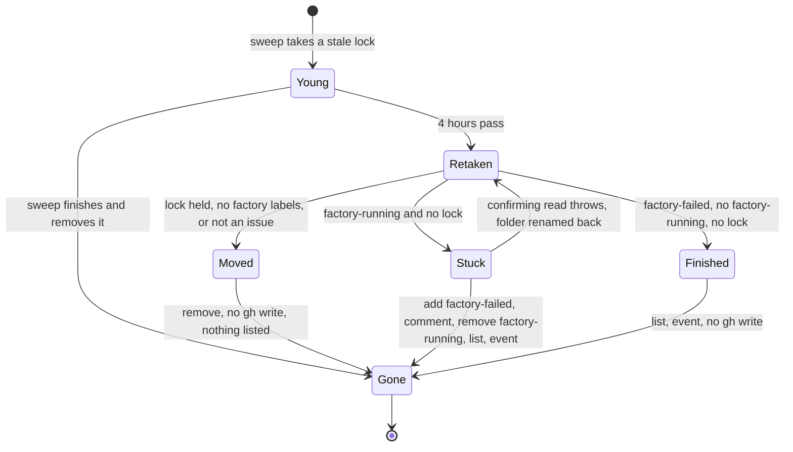

# Plan for #68, pick-up.mjs reports an expired/ folder whose sweep finished the issue

Issue codysseydev/codyssey-skills#68. Base origin/main 99bd2e6. Branch `factory/68`.

Kind: bug fix

## Goal

A folder in `~/.factory/expired/` whose issue has `factory-failed`, no `factory-running` and no lock is finished but was never reported. The re-take in `handleStale` lists it under `stale` and sends the `expired` dashboard event, with no `gh` write, then removes the folder.

## Decided

The owner chose option 1 of the issue on 2026-11-26. It is not open.

## Changed decision

This changes decision 2 of the #21 plan (`.factory/plans/21-pick-up-expired-sweep.md`), "Which old folders are finished". #21 removed a folder whose issue has `factory-failed` and no `factory-running` with no output. #68 reports it. The rest of decision 2 stands.

| Old folder, issue state | Before (#21) | After (#68) |
|---|---|---|
| `factory-running`, no lock | finished, listed, event | same |
| `factory-failed`, no `factory-running`, no lock | removed silently | listed, `expired` event, no `gh` write, folder removed |
| no `factory-failed`, no `factory-running` | removed silently | same |
| a lock holds the issue | removed silently | same |
| the issue is a PR (`getIssue` returns null) | removed silently | same |

The test `expired: a folder whose issue has factory-failed and no factory-running is removed with no gh write` (one of two rows of the loop at `pick-up.test.mjs:1043`) changes as described under Tests.

## Why it happens, read against the code

Line numbers at 99bd2e6, `playbooks/scripts/pick-up.mjs`.

1. A sweep takes a folder (`takeLock`, line 363), adds `factory-failed` (line 508), comments (509), removes `factory-running` (510), then reads the issue again (511). The throw at 512 fires when `factory-running` is still there. A `getIssue` that throws at 511 reaches the same `catch` (515).
2. The `catch` renames the taken folder back to `path` (line 518). For a folder from `expired/`, `path` is its old name with the old take time. For a folder from `locks/`, it is `locks/<lock>`.
3. From `locks/`, the next tick handles it again with no `stillStuck`, so it finishes and reports. No gap.
4. From `expired/`, the next tick sees `now - takenAtMs > STALE_MS` at once, takes it, and calls `stillStuck` (lines 379-384). `factory-running` is gone, so `stillStuck` is false and line 495 removes the folder. No `stale` entry, no event.
5. A SIGKILL between line 510 and `rmSync` (line 524) leaves the folder under its fresh name `expired/<lock>.<now>.<uuid>`. Four hours later the same path runs. Same end state. The issue has `factory-failed` and the comment, and the session never reports `failed`.

The 4-hour wait applies only to the SIGKILL case, where the folder carries a fresh take time. After a thrown read the folder is back under the old name, so the next tick re-takes it at once. The failing test below runs both ticks at the same clock for that reason.

## Change

### `playbooks/scripts/pick-up.mjs`

Replace `stillStuck` (lines 376-384) with `retakeState`, which returns a string instead of a boolean:

```js
// What a re-taken folder's issue looks like now. 'moved': a claim holds it, it has neither label, or it
// is not an issue. 'stuck': factory-running and no lock, so the sweep finishes it. 'finished':
// factory-failed, no factory-running and no lock, so a sweep finished it but nobody reported it.
// Lock, labels, lock again, as before.
function retakeState(d, { repo, issue }) {
  const held = () => existsSync(lockPath(d, repo, issue));
  if (held()) return 'moved';
  const found = d.gh.getIssue(repo, issue);
  if (!found) return 'moved';
  const names = labelNames(found);
  if (held()) return 'moved';
  if (names.includes(RUNNING)) return 'stuck';
  return names.includes(FAILED) ? 'finished' : 'moved';
}
```

In `handleStale`, the re-take block (lines 495-498) and the write block (lines 502-512) change:

```js
let state = 'stuck';
try {
  if (retake && entry.repo) state = retakeState(d, entry);
  if (state === 'moved') {
    if (taken) rmSync(taken, { recursive: true, force: true });
    continue;
  }
  stale.push(entry);
  if (dryRun) continue;
  if (entry.repo && state === 'stuck') {
    // unchanged: ensureLabels, addLabel FAILED, comment, removeLabel RUNNING last, confirming read
  }
} catch (err) { /* unchanged */ }
rmSync(taken, { recursive: true, force: true });
// unchanged: post `expired` when entry.run_id
```

`factory-running` with `factory-failed` stays `stuck` (the `names.includes(RUNNING)` test runs first), so the #21 test for that row keeps its behavior. A `finished` entry has the same shape as a `stuck` one, including `dashboard` after the post. Under `--dry-run` it is listed and nothing is removed or posted, as for `stuck`.

Update the comment above the function and the header comment if it names the outcomes. Nothing else in the file changes.

### `playbooks/factory.md`, "Scheduled pick-up", line 32

Replace this sentence:

```
When the issue has no `factory-running` or a lock holds it, the tick removes the folder and changes no label.
```

with:

```
When the issue has `factory-failed` and no `factory-running` and no lock holds it, a sweep already finished it but was killed or failed its confirming read before it reported. The tick lists the folder under `stale`, sends the `expired` event, changes no label and removes the folder. When a lock holds the issue, or it has neither `factory-running` nor `factory-failed`, the tick removes the folder and changes no label.
```

No other line of the file changes.

## Tests

`playbooks/scripts/pick-up.test.mjs`. The suite is 108 tests at 99bd2e6.

| # | Acceptance criterion | Test |
|---|---|---|
| 1 | A confirming re-read that throws once, and the next tick lists the entry and sends one `expired` event with no `gh` write | NEW `expired: a confirming read that fails once is reported by the next tick with no gh write` |
| 2 | Option 1: the SIGKILL end state is reported | CHANGED, see below |
| 3 | Dry-run lists a finished folder and posts nothing | NEW `expired: dry-run lists a folder whose issue has factory-failed and changes nothing` |
| 4 | The other branches stay silent | existing tests at lines 1031 (lock held), 1043 (`needs-plan-approval`) and the dry-run test at 1164 stay as they are |
| 5 | `node --test playbooks/scripts/pick-up.test.mjs` passes | Gate at the head commit |

The failing test (first build commit, alone, `test: failing test for #68`):

```sh
node --test --test-name-pattern 'a confirming read that fails once' playbooks/scripts/pick-up.test.mjs
```

It starts a folder `expired/o-r-4.<TAKEN>.<uuid>` with the issue at `factory-running`, runs a tick at `LATER` where the second `getIssue` call (the confirming read) throws `HTTP 502`, and asserts the tick rejects, no event went out, and the three `gh` writes happened once. The second tick at the same clock asserts `out.stale` deep-equals `[{ lock: 'o-r-4', repo: R, issue: 4, run_id: 'old', claimed_at: ISO0, dashboard: 'sent' }]`, no `gh` write after the first tick, exactly one `expired` event for `old` in all, and `expired/` empty.

It fails on main for the right reason, see Probes: `out.stale` is `[]` where the entry is expected.

Changed test. In the loop at line 1043, `[['factory', 'needs-plan-approval'], ['factory', 'factory-failed']]`, drop the `factory-failed` row, so the loop keeps the `needs-plan-approval` case. Add `expired: a folder whose issue has factory-failed and no factory-running is listed with the expired event and no gh write`: the issue has `factory`, `factory-failed`; assert `out.stale` is the entry with `dashboard: 'sent'`, `ghWrites(calls)` is `[]`, `events` is `[['expired', 'old']]` and the folder is gone. This is the SIGKILL case (the folder under a fresh name, issue already finished).

New dry-run test: same fixture, `dryRun: true`; assert the entry is listed without `dashboard`, the folder still exists, no `gh` write, no event.

## Probes against the code

Base origin/main 99bd2e6, worktree `agent-ae22d6c1ca0757a66`.

- Baseline gates, all 12 checks of `.factory/recipe.yml`, run from the worktree root. Results are in the Gates section.
- Bug probe. A throwaway copy of the test file (`probe68.test.mjs`, not committed, deleted) with the failing test above appended, run with `node --test --test-name-pattern 'a confirming read that fails once' probe68.test.mjs`. Result at 99bd2e6: 1 test, 0 pass, 1 fail. The first tick rejects with `HTTP 502` as expected, so the first assertions pass. The failure is `AssertionError: Expected values to be strictly deep-equal`, actual `[]`, expected the entry for lock `o-r-4` with `run_id: 'old'`. That is the missing entry. The event assertion that follows would also fail, since `events` is `[]`.
- The second tick needs no 4-hour wait in this test because the rename-back restores the old take time (line 518). The SIGKILL case needs the wait and is the changed test above.

## Diagrams

The new transition on a folder in `expired/` (a status with a new transition) fires the status trigger. The other three triggers do not fire: one actor (the scheduled tick), one module, no new external system.



`Finished` and the `Retaken --> Finished` edge are new. `Stuck --> Retaken` is the path that used to end silently in `Moved`.

## Gates

From the worktree root, at the head commit, clean tree. These are the 12 checks of `.factory/recipe.yml`.

```sh
node --test playbooks/scripts/pick-up.test.mjs
node --test playbooks/scripts/post-merge.test.mjs
node --test playbooks/scripts/capture-ui.test.mjs
node --test playbooks/scripts/trial-decision.test.mjs
node --test playbooks/scripts/test-first.test.mjs
python3 -m unittest discover -s factory/bootstrap/tests
python3 -m unittest discover -s factory/event-model/tests
python3 -m unittest discover -s factory/factory-onboard/tests
python3 -m unittest discover -s kanon/standards-discovery/tests
node --test playbooks/scripts/install.test.mjs
node kanon/scripts/catalog.mjs check --base origin/main
node --test kanon/scripts/catalog.test.mjs
```

Baseline at 99bd2e6: all 12 pass. pick-up 108, post-merge 23, capture-ui 115, trial-decision 39, test-first 36, install 30, kanon catalog tests 43 pass. bootstrap 5, event-model 4, factory-onboard 29, standards-discovery 273 OK. `catalog.mjs check --base origin/main` prints `catalog ok: 14 family file(s), 326 entries`.

Expected after the build: pick-up 110 pass (108, minus the dropped loop row, plus the three new tests), the other 11 unchanged.

## Implement

One delegate, one worktree (`factory/68`), two files plus the test file, no fan-out. Commit order: the failing test alone (`test: failing test for #68`), then the fix with the changed and dry-run tests and the doc line. Trusted-commands flag: none, since `pick-up.mjs` and `playbooks/factory.md` are not on the guard's list.

## Out of scope

- The `locks/` path. It re-handles without `retakeState`, so it has no gap.
- Changing the rename-back target, or the 4-hour wait for a folder that went back under its old name.
- A change to the scheduled task prompt. Step 3 already reports `failed` for each `stale` entry that names `repo` and `issue`, which is what a `finished` entry carries.
- Event model. Skip, no journey for internal tooling. This repo has no brain vault.

## Owner follow-ups

- Copy `playbooks/scripts/pick-up.mjs` and `playbooks/factory.md` to `~/.agents/playbooks/` after merge, as for #21. Nothing syncs them.

## Merge-assessment notes

- Double report. A run that outlived its lock is swept: the sweep moves the lock and is killed before it adds `factory-failed`. That run then gives up on its own, adds `factory-failed` and releases. The later re-take sees `factory-failed`, no `factory-running`, no lock, and reports the entry. The session then sends a second `failed` event for the same run, one from the run itself and one from the sweep. Recommendation: accept it. The run did fail, the events carry the same `run_id`, and telling the two apart needs a record of what the run reported, which pick-up does not have. Not checked: how the dashboard handles two terminal events for one run. If it rejects or double counts, the alternative below applies.
- The SIGKILL case from the issue (killed between label removal and `rmSync`) ends in the `Finished` branch and is covered by the changed test.
- Not exercised: a real `gh` outage, a real SIGKILL. The tests use the fake `gh` and place the folder by hand.

## Open decisions

1. Double `failed` event for a run that failed on its own after a sweep took its lock (see Merge-assessment notes). Chosen (recommended): accept it and report the entry. Alternative: skip the report when the run already reported itself, which needs a way to read what the run sent (the dashboard, or a marker in the issue comments) and one more read per folder.
2. Where the `finished` entry is listed when `claim.json` is unreadable and the repo matches. Chosen (recommended): the same as a `stuck` one, the existing entry shape with `changed_at`, so the session puts it in the final message when it has no `run_id`. Alternative: skip unreadable folders in the `finished` branch and remove them silently.
